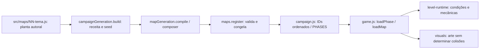
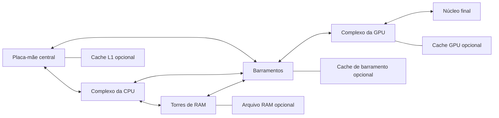
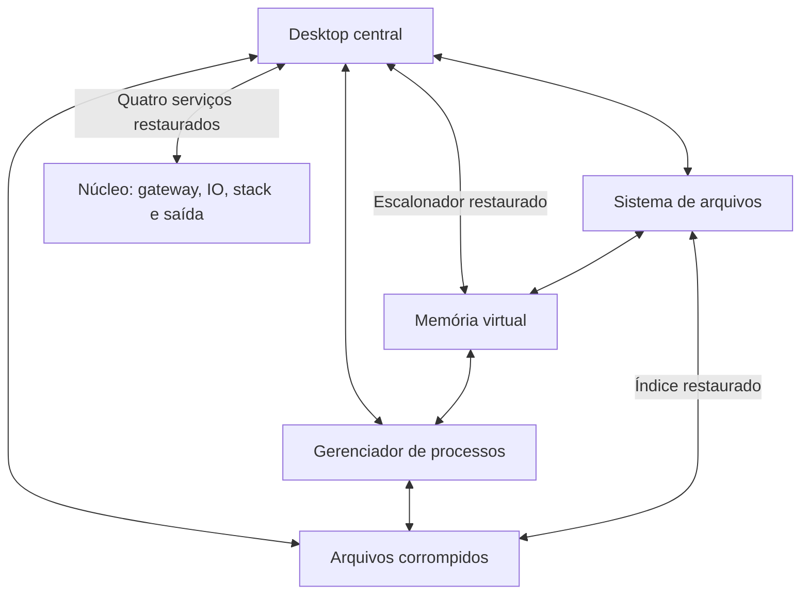

# BYTE RUNNER — preparação da reconstrução dos mapas V3

**Estado:** análise e preparação técnica concluídas em 06/11/2026. **Nenhum mapa reconstruído ou modificado nesta etapa.** A expressão V3 identifica esta iniciativa; não corresponde à revisão numérica atual dos mapas.

## 1. Segurança, referência e limites da etapa

| Item | Estado verificado |
| --- | --- |
| Diretório analisado | Checkout local `jogo WEB`, informado na sessão |
| Remoto `origin` | `https://github.com/AFFODAO/Jogo-WEB.git` |
| Branch inicial | `main`, sem modificações ou arquivos não rastreados no início |
| Commit de referência | `bbe227357432ad48bf22ccb3cc9a6a861d83d75f` — `bbe2273 decimo quarto` |
| Branch de trabalho criada | `rebuild-maps-v3`, a partir desse commit |
| Mapas antigos | Os dez arquivos e o manifesto estão rastreados e preservados no histórico; o último commit que tocou `src/maps/` é `47f6057` |
| Integridade da árvore existente | Os **621 arquivos previamente rastreados** foram comparados por SHA-256 antes/depois da coleta: todos permaneceram idênticos |
| Operações que não foram feitas | Push, merge, rebase, reset, stash, commit, alteração dos mapas ou dos sistemas de produção |
| GitHub remoto | URL conferida no Git local; não foi feito fetch/pull nem verificada eventual atualização remota posterior ao checkout |

A criação da branch exigiu permissão para escrita em `.git`, inicialmente somente leitura no sandbox. Nenhuma alteração local foi descartada. A branch `main` e seus mapas continuam na referência anterior. Exemplo de consulta ao mapa preservado, sem restaurar ou sobrescrever o trabalho:

```powershell
git show bbe2273:src/maps/01-hardware.js
```

**Escopo autorizado agora:** leitura do projeto real, inventário dos mapas efetivamente carregados, execução da referência de testes em cópia isolada, documentação e ferramenta de análise. O jogo inteiro não será reconstruído. Novas geometrias, dimensões, entidades, perguntas, habilidades, física, arena ou regras de salvamento não foram implantadas.

## 2. Arquivos e arquitetura realmente examinados

| Arquivos/pastas existentes | Papel confirmado e consequência para a reconstrução |
| --- | --- |
| `README.md`, `tests/README.md` | Entrada e documentação histórica; vários números e descrições ficaram antigos e não substituem o código atual |
| `game.js` | Coordenação de mapas, movimento, colisões, combate, perguntas, XP/habilidades, checkpoints, salvamento e VIRUS ZERO |
| `index.html`, `style.css` | Ordem real dos scripts clássicos, interface de reparos/perguntas, pausa e apresentação responsiva |
| `src/maps/01-hardware.js` a `10-servers.js` | Plantas autorais explícitas; todas passam por `ByteRunner.campaignGeneration.build(...)` antes do registro |
| `src/maps/campaign.js` | Campanha imutável com `phase-01` a `phase-10`, nessa ordem |
| `src/engine/maps.js` | Registro, clonagem, validação e congelamento; contrato `schemaVersion: 2` |
| `src/engine/platform-physics.js`, `falling-platforms.js` | Parâmetros básicos compartilhados, certificados de salto e ciclo de plataformas que caem |
| `src/engine/level-runtime.js` | Flags, condições, objetivos, mecânicas, interativos, conexões e estado persistível por fase |
| `src/engine/enemies.js` | Perfis, variantes, percepção, suporte, patrulha, preparação de ataques e efeitos específicos |
| `src/engine/repairs.js`, `repair-games.js` | Registro dos reparos e dez diagnósticos modais da campanha |
| `src/engine/experience.js` | Câmera suavizada, conforto, efeitos e áudio; a função de câmera não está em um arquivo separado inventado |
| `src/engine/map-audit.js`, `map-debug.js` | Simulação discreta de travessia, índice espacial e overlay `?dev`; não são prova de dificuldade humana |
| `src/engine/visuals.js`, `environment-art.js`, `pixel-art.js`, `art.js`, `background-scene.js`, `parallax.js`, `parallax-life.js`, `src/content/parallax.js` | Assets, colisões separadas da arte, cache/culling e identidade visual já existente das dez fases |
| `src/content/first-five.js`, `last-five.js`, `parkour.js`, `pacing.js` | Portais, vento/interferência, vigilância, perigos de parkour e caches opcionais |
| `src/generation/campaign.js` | Dez receitas com seeds e rotas de serviço adicionais; também controla a revisão efetiva e a exclusão da arena |
| `src/generation/composer.js`, `config.js`, `validation.js`, `random.js` | Compilação de salas, qualificação de IDs, limites, validação e aleatoriedade determinística |
| `src/generation/graph.js`, `rooms.js`, `structural.js`, `parkour-validation.js`, `gameplay.js`, `demo.js` | Geração opcional de salas/parkour e prévia por URL; não equivale à campanha normal |
| `assets/pixelart/manifest.json`, `assets/pixelart/README.md`, `assets/pixelart/`, `assets/sprites/` | Biblioteca existente: **77 atlas registrados**; 79 PNGs e 22 SVGs presentes em `assets/`, além de JSON/documentação. Quantidade de arquivos não é quantidade de assets carregados |
| `tools/build_first_five.py`, `build_last_five.py`, `build_environment_art.py`, `import_maps.py` | Fontes de geração/importação; executar os dois primeiros reescreve mapas e pode apagar edições manuais futuras |
| `tools/check_maps.py`, `check_environment.py`, `check_generation.py`, `check_parallax.py`, `check_hardware_depth.py` | Guardas atuais de mapas, sistemas, ordem de scripts e atlas |
| `tests/run_review.py`, `review.js`, `architecture.js`, `first-five.js`, `last-five.js`, `enemies.js`, `repairs.js`, `experience.js`, `campaign-generation.js`, `final-regressions.js` e fixtures | Regressão real, auditoria de percurso, contratos históricos e limitações do método |
| `docs/architecture.md`, `docs/campaign-generation-1-5.md`, `docs/campaign-generation-6-10.md`, `docs/parallax-final-review.md`, `PROGRESSO_MAPAS.md` | Contexto de arquitetura, geração e limites anteriores de desempenho |

O levantamento dos assets é estrutural, de manifestos e referências; não representa uma revisão artística individual de cada arquivo. As capturas panorâmicas foram preservadas na referência desta etapa para inspeção dos mapas.

### Caminho real do mapa até o jogo



As rotas adicionais não ficam todas escritas em `src/maps/`. Contar apenas os JSONs autorais subestima o jogo carregado: há **242 plataformas autorais e 282 compiladas**. Os 40 acréscimos incluem percursos de serviço e um elevador de transmissão. As contagens deste documento usam as definições compiladas, distinguindo conteúdo condicional de conteúdo ativo.

## 3. Contratos dos sistemas a preservar

### Física, movimento e colisão

- Corpo do R-07: **34 × 48 px**; sprite principal: **32 × 48 px**, desenhado com ajuste lateral. Não redimensionar colisões para acompanhar a arte.
- Velocidade básica: **255 px/s**; impulso do salto: **690 px/s**; gravidade: **1.850 px/s²**; velocidade terminal vertical usada na simulação: **1.050 px/s**.
- Sem vento, interferência ou habilidades: altura balística **128,676 px**, voo para altura igual **0,746 s**, deslocamento horizontal teórico **190,216 px**. Isso não é uma autorização para vãos de 190 px entre plataformas: largura do corpo, subida, tetos e margens de aterrissagem reduzem o espaço útil.
- `platformPhysics.canReach` usa intervalos de apoio, margem de seis pixels, largura mínima de corpo + 12 e fator conservador 0,82. Usar esse contrato e depois validar com `movePlayer`; não projetar por distância entre centros.
- `game.js` integra a gravidade pela velocidade média do passo, resolve X/Y, trata plataformas `one-way` e reaplica limites laterais. A atualização usa acumulador de **1/120 s**, limitado a oito passos por frame.
- Pisos explícitos não criam um chão global de segurança. Cair abaixo de `worldHeight() + 180` dispara recuperação. Plataformas móveis, temporárias e que caem possuem estado por fase; sua envoltória inteira precisa ficar livre.
- Vento, sinal fraco, infecção e interferência alteram deslocamento/disparo. Todo caminho obrigatório futuro deve ser possível com atributos básicos e nos extremos das mecânicas, sem depender de `boost`.

### Câmera e progressão espacial

As dez definições compiladas permitem **X e Y**, mesmo quando o layout é horizontal ou vertical. O compositor configura offsets de acompanhamento em 0,44/0,55. `experience.camera` suaviza a posição, antecipa a velocidade, mantém limites do mundo e um envelope vertical de segurança. Portais posicionam a câmera imediatamente no destino.

As dez plantas compiladas usam atualmente `map.progress.axis: 'objectives'`. A direção visual do mapa não determina sozinha o progresso. Ampliar a geometria pode deixar a barra quase parada entre reparos; isso deverá ser resolvido nos dados e no desenho dos objetivos, sem trocar a física/câmera nesta preparação.

### Registro, IDs e geração

Manter `schemaVersion: 2`, os dez IDs da campanha, a ordem dos temas e o namespace `ByteRunner`. Definições são imutáveis; dano, reparos e flags pertencem ao runtime. Referências em `requires`, `disabledWhen`, `opensWhen`, `requiresComponentId`, portais e objetivos precisam apontar para IDs válidos.

O compositor qualifica referências por sala, inclusive condições, patrulhas, limites do chefe e destinos. A campanha atual usa uma macro-sala `world` e remove esse prefixo para manter compatibilidade de IDs. Não remover essa normalização ou misturar IDs qualificados e legados por acidente.

Limites atuais de `src/generation/config.js`: **64 salas**, dimensão máxima de **32.768 px** por eixo e **2.048 entidades por sala**. São limites de validação, não orçamentos seguros de desempenho.

### Inimigos, combate e VIRUS ZERO

Perfis existentes: `basic/common`, `fast`, `armored`, `flyer`, `shooter`, `parasite` e `boss`; variantes temáticas incluem arquivo/fork, pacote, Wi-Fi, DNS e firewall. Patrulha, suporte, linha de visão, `navigationBounds`, `groundY` e `activationRegion` precisam acompanhar a nova geometria. Inimigos terrestres não devem nascer em plataformas que só aparecerão depois de um reparo.

Os projéteis do jogador mantêm a assimetria atual de atravessar obstáculos; projéteis inimigos são bloqueados por sólidos. Isso é comportamento existente, não uma regra nova proposta para V3.

O chefe efetivo da fase 10 é **`e08`**, com **90 HP e 500 XP**, e não apenas os valores padrão menores do perfil `boss`. Seus limites atuais são `left:4880/right:6500`; ativação em `(4800,320,1800,650)`; há checkpoint em `(5000,900)`. A conclusão usa `{type:'boss-question', enemyId:'e08'}`.

O escudo consulta **todos os componentes não reparados da fase**, não uma lista isolada de relays. Acrescentar um componente supostamente opcional pode impedir a vitória. O chefe possui três etapas, transições protegidas, telegráficos, investida, rajada, onda/surge, combo, invocação e ponto fraco. Esses comportamentos devem permanecer; a nova arena precisará fornecer cobertura, espaço de desvio e apoio compatíveis.

### Reparos, minigames e objetivos

Os tipos reais por tema são `circuit`, `software`, `ethernet`, `route`, `wifi`, `cabling`, `dhcp`, `dns`, `firewall`, `servers`. `createComponents` escolhe `repairChallenges.forPhase(phaseIndex, componentIndex)` quando não há um reparo explícito não legado. `hold` e `sequence` continuam registrados como extensões; os diagnósticos atuais da campanha são modais, pausam o mundo e usam o painel compartilhado.

Sucesso repara o componente, limpa corrupção, emite o evento, concede 30 XP, reavalia objetivos e salva. Falha/cancelamento não pode concluir o reparo. A dificuldade/variação também depende de `componentIndex`; aumentar o número de componentes aumenta a repetição e pode alterar o tamanho dos desafios.

As dez fases exigem atualmente todos os reparos e o total configurado de inimigos, além da pergunta educativa. Switch, DHCP e Firewall têm condições adicionais explícitas por flags. Aumentar inimigos/reparos sem atualizar contadores e dependências pode criar bloqueios ou liberações prematuras. `createViruses` inicializa inimigos declarados como `countsForObjective:true`; não basta pôr `false` no JSON para criar um encontro opcional.

### Checkpoints e recuperação

Há modos `legacy`, `proximity`, `ordered` e `free`. A campanha usa `proximity` ou `free`, conforme a tabela abaixo. Para pontos com Y, a ativação exige proximidade horizontal e pés a até 24 px da cota. A recuperação usa **`checkpointX + 38`** e `checkpointY - altura`.

Um checkpoint futuro precisa funcionar antes dos reparos, ter piso permanente suficiente para essa posição deslocada e estar fora de lasers, portais conflitantes, inimigos e envoltórias móveis. Ordenar pontos por X é incorreto para hubs e subidas; manter a modalidade adequada à planta.

### Perguntas, XP e habilidades

`QUESTION_BANK`, em `game.js`, contém **dez perguntas por tema**. IDs e histórico são mantidos em `byteRunner.usedQuestions.v1`; opções são embaralhadas. Resposta errada marca `questionRetryRequired`, persiste e exige repetir a fase. Em mapas muito longos essa penalidade cresce bastante: a regra deve ser preservada e avaliada conscientemente, sem amenização silenciosa nesta etapa.

XP existente: reparo 30, fragmento 20, grupos de objetivos 100 cada; inimigos usam seus perfis/especificações e minions têm regra própria. Limiar do próximo nível: `100 + (nível - 1) × 45`. Habilidades existentes: `armor`, `rapid`, `cannon`, `boost`, `shield`, `repair`, com escolha pendente persistida. Expandir o conteúdo sem orçamento de XP pode saturar habilidades cedo e descaracterizar combate/dificuldade. O percurso obrigatório continuará validado com atributos básicos.

### Salvamento e revisão dos mapas

- Chave da campanha normal: **`byteRunner.campaign.v1`**; formato salvo `version:1`. Guarda `phaseId`, `phaseIndex`, `mapRevision`, XP, nível, habilidades, checkpoint, flags/mecânicas e progresso das entidades.
- Inimigos, reparos, integridade de componentes e coletáveis ainda são restaurados **por posição nos arrays**, apesar dos IDs. Mesma revisão + listas reordenadas pode aplicar progresso ao objeto errado.
- `continueCampaign` compara a revisão efetiva do mapa. Quando mudou, reinicia o estado espacial e os objetivos da fase, preservando XP, nível, habilidades e desbloqueios; a saúde segue as regras existentes de retomada/retry. A escolha pendente é reaberta quando aplicável.
- Revisões efetivas atuais: **3 nas fases 1–5 e 7–10; 4 em Cabeamento**. Os blueprints ainda dizem revisão 2. **Editar só `revision` no arquivo da fase não basta**: `campaignGeneration.build` usa `settings.revision || 3`.
- Decisão de preparação: reservar **revisão efetiva 5 ou superior** para as plantas reconstruídas. O número V3 da iniciativa não autoriza reutilizar a revisão efetiva 3 já publicada. A alteração será feita somente na etapa de reconstrução.
- Não trocar a chave da campanha, apagar `localStorage` ou resetar XP para resolver incompatibilidade. Histórico de perguntas, som, conforto e cenário têm chaves separadas.
- Prévia procedural usa chaves `byteRunner.rooms.v1:`/`byteRunner.procedural.v1:` e modifica a campanha apenas quando a URL a solicita. Não confundir essa prévia com os dez mapas normais.

## 4. Inventário das dez fases atuais

### Método da estimativa de área explorável

O retângulo do mundo inclui ar, tetos e espaços sem apoio; por isso sua área não é chamada de área explorável. Foi estimada uma **faixa candidata de navegação** a partir dos intervalos onde o corpo pode ficar apoiado sem penetrar em outra geometria (`surfaces()` da auditoria).

Sobre cada intervalo, projeta-se uma faixa de **48 + 128,676 = 176,676 px** de altura: corpo em pé mais um salto básico. A união dessas faixas é recortada ao mundo e subtraída da união dos sólidos, sem contar sobreposições duas vezes. Foram medidos dois estados em `animationTime = 0`: inicial e com todos os componentes reparados. **Flags de terminais, ciclos móveis e visitas não foram forçados nesse segundo estado.**

Essa é uma estimativa geométrica útil para comparar plantas, **não uma prova de alcançabilidade de toda a faixa, tempo de exploração ou área varrida numa partida**. Plataformas one-way são tratadas geometricamente como retângulos; portais e fases temporais exigem avaliação à parte. As áreas livres totais e todas as coordenadas estão em [inventory.json](tests/rebuild-v3-baseline/inventory.json). A regressão de percurso complementa, mas não transforma essa aproximação em uma partida contínua.

Áreas abaixo em **milhões de px²**, arredondadas a três casas; `início → reparos` usa os dois estados descritos.

| Fase / tema | Dimensões em px | Retângulo do mundo | Faixa candidata início → reparos | Formato compilado |
| --- | --- | ---: | ---: | --- |
| 1 Hardware | 2800 × 1000 | 2,800 | 0,783 → 0,874 | horizontal |
| 2 Software | 1900 × 1400 | 2,660 | 0,668 → 0,753 | hub |
| 3 Switch | 2200 × 1200 | 2,640 | 0,782 → 0,903 | multi-route |
| 4 Roteador | 2200 × 1500 | 3,300 | 1,133 → 1,204 | maze |
| 5 Wi-Fi | 1550 × 2400 | 3,720 | 0,861 → 1,001 | vertical |
| 6 Cabeamento | 1600 × 3000 | 4,800 | 1,693 → 1,973 | vertical |
| 7 DHCP | 2800 × 1700 | 4,760 | 0,663 → 0,949 | hub |
| 8 DNS | 3400 × 2100 | 7,140 | 1,780 → 2,001 | maze |
| 9 Firewall | 3600 × 1800 | 6,480 | 1,492 → 1,577 | multi-route |
| 10 Servidores | 6800 × 2000 | 13,600 | 2,060 → 2,316 | multi-route |

### Quantidades declaradas

`P autorais → compiladas` não inclui os segmentos de chão. Condições podem manter uma plataforma/obstáculo inativo no início. Inimigos são os declarados, sem somar invocações futuras. Caches gerados por `pacing` não foram misturados aos coletáveis declarados.

| Fase | Segmentos de chão | P autorais → compiladas | Inimigos | Reparos | Coletáveis | Obstáculos / gates | Checkpoints / modo |
| --- | ---: | ---: | ---: | ---: | ---: | ---: | --- |
| 1 | 3 | 17 → 20 | 3 | 3 | 5 | 2 / 0 | 3 / proximity |
| 2 | 4 | 11 → 14 | 3 | 3 | 4 | 10 / 0 | 3 / free |
| 3 | 5 | 23 → 27 | 3 | 3 | 4 | 0 / 0 | 3 / free |
| 4 | 4 | 17 → 20 | 3 | 3 | 4 | 2 / 0 | 3 / free |
| 5 | 5 | 26 → 29 | 3 | 3 | 5 | 0 / 0 | 4 / proximity |
| 6 | 8 | 36 → 44 | 4 | 3 | 4 | 5 / 0 | 4 / proximity |
| 7 | 5 | 18 → 21 | 4 | 3 | 4 | 1 / 1 | 4 / free |
| 8 | 8 | 33 → 36 | 5 | 3 | 5 | 6 / 0 | 4 / free |
| 9 | 6 | 17 → 21 | 5 | 4 | 4 | 4 / 4 | 5 / free |
| 10 | 8 | 44 → 50 | 8 | 4 | 6 | 4 / 1 | 5 / free |
| **Total** | **56** | **242 → 282** | **41** | **32** | **45** | **34 / 6** | **38** |

### Fase 1 — Hardware

- **Fonte e regiões:** `src/maps/01-hardware.js`; CPU, RAM, GPU e BUS; placa-mãe, refrigeração e caches L1/RAM. Entrada `(70,802)`; saída regional `(2670,786,90,64)`.
- **Plataformas e combate:** 20 fixas compiladas; `basic`, `fast`, `armored`, um de cada. Há vento na região de refrigeração, desligado pelo reparo da CPU.
- **Objetivos:** reparar `c01` soquete da CPU, `c02` banco de RAM e `c03` alimentação da GPU; derrotar os três inimigos e responder à pergunta. Minigame `circuit`.
- **Checkpoints:** `(1050,850)`, `(1400,510)`, `(2000,850)`.
- **Diagnóstico de design:** a progressão obrigatória se concentra em três serviços; simplesmente alongar a placa criaria trechos vazios. O primeiro checkpoint fica 980 px à direita da entrada, uma referência a reavaliar ao ampliar. A rota opcional de serviço tem três degraus; isso acrescenta geometria, não uma nova missão. Vento deve entrar no teste de retorno e de salto básico.

### Fase 2 — Software

- **Fonte e regiões:** `src/maps/02-software.js`; desktop, processos, arquivos e escalonador em quatro salas. Entrada `(280,1202)`; saída `(1660,1186,90,64)`.
- **Plataformas e combate:** 12 fixas + duas móveis; dez obstáculos. Inimigos `fast`, `basic`, `shooter`.
- **Objetivos:** `c01` processo do sistema, `c02` índice de arquivos, `c03` escalonador; três inimigos e pergunta. Minigame `software`. Há oito conexões de diretório declaradas, seis ativas no início e oito com reparos.
- **Checkpoints:** `(180,650)`, `(1250,650)`, `(1300,1250)`.
- **Diagnóstico:** a topologia de quatro salas e os portais encurtam a viagem física; aumentar largura sem ampliar tarefas não aumenta proporcionalmente a duração. É preciso diferenciar subdiretórios, criar retornos legíveis e conservar destinos seguros em ambos os sentidos. O excesso de portais similares pode desorientar sem marcos e rotas claras.

### Fase 3 — Switch

- **Fonte e regiões:** `src/maps/03-switch.js`; backplane/uplink e quatro portas Ethernet. Entrada central `(1000,992)`; saída `(1050,386,90,64)`.
- **Plataformas e combate:** 26 fixas + um elevador móvel acrescentado pela receita. Inimigos `basic`, `parasite`, `shooter`.
- **Objetivos:** `c01` conector Ethernet, `c02` enlace da porta 04, `c03` backplane; flags **`port-a` e `port-b`** do objetivo `active-ports`; três inimigos e pergunta. Minigame `ethernet`.
- **Checkpoints:** `(1010,1040)`, `(260,900)`, `(1880,400)`.
- **Diagnóstico:** há quatro regiões de portas, mas apenas três encontros declarados; ampliar deve criar funções distintas para ramais, não repetição de escadas. Os quatro itens visuais de portas aparecem duplicados nos dados autorais nas mesmas posições, sem conteúdo jogável adicional. O elevador e as ativações precisam continuar compatíveis com atributos básicos e salvamento de flags.

### Fase 4 — Roteador

- **Fonte e regiões:** `src/maps/04-router.js`; LAN inferior, trânsito, WAN e rota superior/reserva. Entrada `(150,1272)`; saída `(1950,436,90,64)`.
- **Plataformas e combate:** 20 fixas, dois obstáculos; `fast`, `flyer`, `armored`.
- **Objetivos:** tabelas LAN `c01`, trânsito `c02`, WAN `c03`; três inimigos e pergunta. Minigame `route`. Cinco interfaces declaradas, duas disponíveis inicialmente.
- **Checkpoints:** `(1740,1320)`, `(600,950)`, `(1830,500)`.
- **Diagnóstico:** o labirinto usa poucos troncos largos e interfaces que encurtam o trajeto. A V3 precisa ter decisões e caminhos de encaminhamento reconhecíveis, evitando só ampliar corredores ou impor retornos longos pelo mesmo trecho. Portais não podem contornar dependências obrigatórias nem entregar o jogador dentro de novas paredes.

### Fase 5 — Wi-Fi

- **Fonte e regiões:** `src/maps/05-wifi.js`; associação, AP A, repetidor, AP B e uplink, com antena auxiliar. Entrada `(160,2192)`; saída `(740,286,90,64)`.
- **Plataformas e combate:** 21 fixas, três móveis, cinco temporárias; `shooter`, `flyer`, `basic`. Quatro zonas ambientais de sinal/interferência.
- **Objetivos:** `c01` AP A, `c02` repetidor, `c03` AP B; três inimigos e pergunta. Minigame `wifi`.
- **Checkpoints:** `(1040,1880)`, `(240,1520)`, `(1160,1160)`, `(720,620)`.
- **Diagnóstico:** a subida combina plataformas temporárias e velocidade reduzida; uma escala geométrica simples produziria saltos impossíveis. Quedas entre andares maiores podem custar muito tempo. Os cinco itens visuais principais de antenas também estão duplicados nos dados autorais. São necessários apoios permanentes de recuperação e ramais com recompensa real, sem exigir propulsor.

### Fase 6 — Cabeamento

- **Fonte e regiões:** `src/maps/06-cabling.js`; subsolo, shafts oeste/leste, manutenção, elevadores e cobertura. Entrada `(200,2752)`; saída `(1280,336,90,64)`. Há uma sala visual de manutenção adicional na receita.
- **Plataformas e combate:** 41 fixas + três móveis; cinco obstáculos; `basic`, `fast`, `parasite`, `shooter`.
- **Objetivos:** quadro do shaft A `c01`, patch panel B `c02`, distribuidor do topo `c03`; quatro inimigos e pergunta. Minigame `cabling`.
- **Checkpoints:** `(260,2200)`, `(1190,1600)`, `(260,1000)`, `(1200,400)`.
- **Diagnóstico:** quatro intervalos de aproximadamente 600 px verticais dominam a recuperação, enquanto os encontros obrigatórios são poucos para o edifício. O desenho repete a alternância de shafts e já contém correções de travessia de retorno; recriar pontes contínuas pode reintroduzir bloqueios. Uma expansão precisa criar andares com funções distintas e evitar que falhas de elevador/retorno obriguem a refazer grande parte da subida. Revisão efetiva já é 4.

### Fase 7 — DHCP

- **Fonte e regiões:** `src/maps/07-dhcp.js`; distribuidor central, reservas `10.0.10`, diagnóstico APIPA, relay `10.0.20` e gateway `10.0.30`. Entrada `(1370,952)`; saída `(2490,696,90,64)`.
- **Plataformas e combate:** 16 fixas + cinco móveis; um obstáculo e um gate; `fast`, `armored`, `flyer`, `basic`. Oito conexões declaradas e uma zona de conflito IP.
- **Objetivos:** serviço DHCP `c01`, pool em conflito `c02`, relay `c03`; flags **`dhcp-on` e `reservation`** do objetivo `ip-services`; quatro inimigos e pergunta. Minigame `dhcp`.
- **Checkpoints:** `(1430,1000)`, `(300,650)`, `(2270,1450)`, `(2330,760)`.
- **Diagnóstico:** a faixa útil inicial é pequena em relação ao retângulo do mundo, e a exploração depende bastante de gateways e concessões. Expansão deve aprofundar cada sub-rede e sua função, não aumentar o vazio entre hubs. Preservar destinos/retornos seguros e não criar ciclo em que um serviço necessário só seja alcançável após reparar a si próprio.

### Fase 8 — DNS

- **Fonte e regiões:** `src/maps/08-dns.js`; raiz, `.com`, `mail.com`, `.org`, `api.org`, resolvedor recursivo, cache TTL e NXDOMAIN. Entrada `(1600,352)`; saída próxima da raiz `(1940,336,90,64)`.
- **Plataformas e combate:** 36 fixas, seis obstáculos; `shooter`, `fast`, `basic`, `parasite`, `armored`.
- **Objetivos:** MX/.com `c01`, A/.org `c02`, cache recursivo `c03`; cinco inimigos e pergunta. Minigame `dns`. Dezesseis links declarados, onze disponíveis no início, incluindo o atalho TTL adicional.
- **Checkpoints:** `(1580,400)`, `(400,1200)`, `(2900,1200)`, `(1510,1550)`.
- **Diagnóstico:** muitos destinos e retorno final próximo da entrada tornam orientação e entendimento dos desbloqueios essenciais. A área NXDOMAIN precisa justificar o desvio; ampliar becos sem recompensa só aumenta punição. O atalho TTL deve reduzir retorno depois da descoberta, sem pular tarefas obrigatórias. Evitar portais de chegada que ativem outra conexão imediatamente.

### Fase 9 — Firewall

- **Fonte e regiões:** `src/maps/09-firewall.js`; perímetro, duto de infiltração, bastiões, anel interno e cidadela. Entrada `(120,1512)`; saída `(2460,476,90,64)`.
- **Plataformas e combate:** 19 fixas, uma móvel, uma temporária; quatro obstáculos e quatro gates; `fast`, `shooter`, dois `armored`, um `flyer`. Duas câmeras de vigilância.
- **Objetivos:** quatro políticas/regras `c01`–`c04`, flag **`rules-on`** de `security-policy`, cinco inimigos e pergunta. Minigame `firewall`.
- **Checkpoints:** `(1450,1560)`, `(3200,1560)`, `(2300,1140)`, `(1050,1140)`, `(2200,540)`.
- **Diagnóstico:** a dependência entre camadas, câmeras e gates pode virar um percurso de retorno excessivo em uma fortaleza maior. Acumular lasers, blindados e tiros sem áreas de espera comprometeria a leitura. Separar entradas, preparação e fuga; conferir o retorno após todos os estados de reparo e não somente a ida com tudo aberto.

### Fase 10 — Servidores e VIRUS ZERO

- **Fonte e regiões:** `src/maps/10-servers.js`; torres A/B, fibra óptica, backbone, airlock e núcleo elevado. Entrada `(200,1592)`; saída `(6480,836,90,64)`.
- **Plataformas e combate:** 46 fixas, três móveis, uma temporária; quatro obstáculos e um gate. `basic`, dois `shooter`, `flyer`, `parasite`, `fast`, `armored`, `boss`.
- **Objetivos:** relays `c01`–`c04`, oito inimigos incluindo `e08`, pergunta final e conclusão `boss-question`. Minigame `servers`. O reparo de todos os componentes mantém a regra atual do escudo.
- **Checkpoints:** `(640,1190)`, `(1850,1050)`, `(2910,1640)`, `(4450,1170)`, `(5000,900)`.
- **Diagnóstico:** já é o maior retângulo da campanha, mas a faixa candidata de navegação reparada ocupa cerca de 17% dele. Aumentar só suas dimensões ampliaria espaços vazios. A arena atual e seus padrões foram ajustados a coordenadas específicas. `src/generation/campaign.js` proíbe conteúdo gerado a partir de **x = 4800** e declara uma área manual até x = 6800; deixar esses números intactos bloquearia uma ampliação real. A V3 deve reconstruir o percurso macro e redesenhar espacialmente a arena, preservando o comportamento do chefe e atualizando juntos exclusão, limites, ativação, relays, checkpoint e saída.

## 5. Riscos e decisões de preparação

| Prioridade | Risco observado | Decisão / tratamento necessário na reconstrução futura |
| --- | --- | --- |
| Crítica | Save por índices e coordenadas; revisões efetivas 3/4 já publicadas | Usar revisão efetiva 5+ nas novas plantas; validar migração mantendo progressão global e resetando estado espacial incompatível |
| Crítica | Mudar só os blueprints não muda a revisão efetiva nem todas as plataformas | Alterar de forma coordenada a autoria e as receitas em `src/generation/campaign.js`; conferir sempre o mapa compilado |
| Crítica | Dependências de reparos/portais/gates podem formar ciclo ou deixar objetivo obrigatório inacessível | Grafo de pré-requisitos com caminho inicial sem habilidades; testar estados anteriores/intermediários/posteriores e o retorno |
| Crítica | Escudo do chefe depende de todos os componentes; `countsForObjective` é imposto aos inimigos declarados | Não tratar novos componentes/inimigos como opcionais só por um campo no JSON; planejar os objetivos explicitamente antes de inserir conteúdo |
| Alta | Arena, limites, ativação e exclusão do gerador têm coordenadas fixas | Parametrizar/atualizar os dados da arena conjuntamente na futura etapa, sem alterar os padrões de combate silenciosamente |
| Alta | Alterações diretas podem ser sobrescritas por `build_first_five.py`/`build_last_five.py` | Escolher uma fonte autoral reproduzível e atualizar ferramenta e saída juntas; não executar os builders nesta preparação |
| Alta | Mais entidades aumentam custo de `solids()`, colisões, HUD/minimapa e IA; expansão de piso/conexões da IA pode ter custo quadrático | Orçar por setor, usar regiões de ativação e medir cena cheia; otimização de engine só se necessária e testada separadamente |
| Alta | Mais inimigos/reparos elevam XP e frequência de escolhas/pausas | Orçamento de progressão por fase, variação e espaçamento de desafios; preservar os coeficientes globais por padrão |
| Alta | Repetir uma fase muito maior após pergunta errada pode ser frustrante | Manter a regra existente nesta iniciativa até decisão explícita em contrário; avaliar o percurso completo e a sinalização final |
| Alta | Checkpoints herdados podem aparecer sobre vazio/perigo ou sem espaço para +38 px de respawn | Validar estabilidade antes dos reparos, suporte permanente, envoltória do corpo e perigos em ciclos distintos |
| Alta | Guardas atuais congelam hashes/coordenadas/revisões das plantas antigas | Criar fixtures novas versionadas e adaptar testes de conteúdo de forma controlada; não desligar testes nem regravar todo baseline para esconder falhas |
| Média | README cita 47 atlas/37 inimigos e descrições históricas; código atual tem 77 atlas registrados/41 inimigos declarados | Usar esta referência medida; atualizar documentação de produto somente quando as novas plantas forem entregues |
| Média | Alguns itens decorativos estão duplicados e o minimapa pode perder legibilidade em mundos maiores | Deduplicar dados na nova autoria e avaliar escala/orientação do mapa; arte de fundo não pode sugerir piso colidível |
| Média | A linguagem V3 pode ser confundida com os seeds e revisões 3 já existentes | Separar nome da iniciativa, seed/receita e revisão efetiva; registrar todas as três |

### Diretrizes aceitas para a próxima etapa — ainda não implementadas

1. Reconstruir plantas, rotas, distribuição e conteúdo, preservando os dez temas e IDs. Não esticar coordenadas do desenho atual nem repetir o mesmo mapa com outra paleta.
2. Preservar os formatos reconhecíveis: placa horizontal, hub de software, switch ramificado, roteador em labirinto, Wi-Fi/cabeamento verticais, hub DHCP, labirinto DNS, fortaleza e data center com arena.
3. Planejar primeiro grafo macro, objetivos/pré-requisitos, percurso crítico, retornos/atalhos e recuperação; depois encaixar os saltos reais e os encontros. Evitar depender de plataforma temporária como único apoio de recuperação.
4. Como **meta preliminar de projeto**, buscar percurso crítico substancialmente maior (referência inicial: cerca de 3×) e pelo menos 2,5× a faixa útil candidata de navegação, acompanhados por setores funcionais e variedade. Esses fatores não são dimensões finais nem duração prometida; precisam de protótipo e medição. Nenhum tamanho novo foi escolhido nesta etapa.
5. Definir orçamento de conteúdo e XP por setor antes de multiplicar inimigos e minigames. Contar decisões, desafios, recompensas e caminhos úteis, não apenas plataformas ou metros de ar.
6. Separar obrigatório e opcional com requisitos explícitos e funções suportadas pelo runtime. Segredos devem recompensar exploração e permitir retorno; habilidades opcionais podem facilitar, nunca bloquear a campanha básica.
7. Preservar o sistema visual e de parallax existente, associando a nova arquitetura/regiões aos seus dados. Os quatro marcos ambientais atuais não equivalem automaticamente a todos os setores de um mapa maior.
8. Reconstruir **uma fase por vez**, na ordem 1 a 10, com validação de geometria, ida/retorno, objetivos, checkpoint, morte, save, pergunta e combate antes de seguir. Definir então novas metas quantitativas por fase e registrar aqui a aprovação de cada marco.

## 6. Preparação técnica criada nesta etapa

- [tools/analyze_rebuild_maps_v3.py](tools/analyze_rebuild_maps_v3.py): coletor de baseline. Faz uma cópia temporária do projeto, executa os verificadores e a suíte existente, coleta as dez definições compiladas pelo navegador e calcula as áreas. Não chama os builders de mapas.
- [tests/rebuild-v3-baseline/inventory.json](tests/rebuild-v3-baseline/inventory.json): definições compiladas, receitas/blueprints de referência, atores reais, reparos, contagens autorais, condições, conexões, superfícies e estimativas de área.
- [tests/rebuild-v3-baseline/regression-results.json](tests/rebuild-v3-baseline/regression-results.json): resultado da regressão executada nesta preparação, separado dos relatórios anteriores.
- [tests/rebuild-v3-baseline/execution.json](tests/rebuild-v3-baseline/execution.json): comandos, retornos, saídas e SHA-256 dos 621 arquivos previamente rastreados; registra a preservação desses arquivos e a remoção da cópia temporária.
- `tests/rebuild-v3-baseline/captures/phase-NN-overview.png`: dez panoramas da execução isolada. Exemplos inspecionados: [Cabeamento](tests/rebuild-v3-baseline/captures/phase-06-overview.png) e [Servidores](tests/rebuild-v3-baseline/captures/phase-10-overview.png).

O coletor se recusa a sobrescrever um diretório de baseline existente. `--inventory-only` reutiliza somente a regressão já concluída e exige o mesmo HEAD e os mesmos hashes dos arquivos rastreados. Não substitui uma nova regressão quando o projeto mudar. Os testes usam perfil de Chrome temporário e não acessam o salvamento pessoal do jogador.

## 7. Testes realmente executados agora

Todos os comandos de jogo foram executados **na cópia temporária**, com o código do commit de referência. O fingerprint dos arquivos de produção no relatório é `ddf1cacc2559935f83f9194b2f29951effe78bca08ec7a1b268b511dd0b246da`.

| Comando / verificação | Resultado observado |
| --- | --- |
| `python tools/check_maps.py` | Dez módulos e manifesto válidos |
| `python tools/check_parallax.py` | Mapas/campanha e sistemas protegidos; mudanças históricas de apresentação reconhecidas |
| `python tools/check_environment.py` | Campanha, física, chefe e reparos preservados |
| `python tools/check_generation.py` | Infraestrutura e ordem de scripts válidas |
| `python tools/check_hardware_depth.py` | Atlas, silhuetas, recortes e manifestos concordantes |
| `python tests/run_review.py` | **209/209** verificações, dez fases, 92 capturas, zero erros de runtime e nenhuma falha |
| Coleta/validação compilada em Chrome | **10/10** mapas validados e exportados; estados inicial e reparado coletados |
| SHA-256 antes/depois | **621/621 arquivos existentes idênticos**, incluindo fontes, mapas e relatórios previamente rastreados |

A primeira coleta auxiliar usou um nome incorreto para a constante das perguntas; a segunda esbarrou na saída CP1252 do Windows ao imprimir rótulos com setas. O coletor foi corrigido para o nome real `QUESTION_BANK` e para execução UTF-8. As tentativas e os retornos ficam em `execution.json`; a regressão do jogo já havia passado e não foi alterada para resolver esses erros do coletor.

**Cobertura/limitações:** a suíte usa movimento real em trechos amostrados, mas pode reposicionar o jogador entre arestas comprovadas e usa proteção contra dano em testes de combate. Não é uma partida humana contínua nem avaliação de duração, dificuldade, fadiga ou sobrevivência. A estimativa de área não mede todos os ciclos temporais. Não foi feita nova medição de FPS, teste físico mobile, áudio por escuta ou teste de outros navegadores nesta preparação. O relatório anterior de parallax registra limitações de desempenho em alta densidade; isso é histórico a revalidar nas futuras plantas, não um novo benchmark desta etapa.

## 8. Progresso e ponto de parada

- [x] Checkout/remoto/HEAD e estado limpo inicial verificados.
- [x] Branch `rebuild-maps-v3` criada; histórico dos mapas antigos preservado.
- [x] Sistemas, geração, contratos de saves e riscos analisados.
- [x] Dez plantas autorais e compiladas inventariadas, com áreas estimadas e diagnóstico individual.
- [x] Baseline de testes isolado e artefatos de referência preservados.
- [x] Decisões e critérios para a reconstrução registrados.
- [ ] Reconstrução de geometria e conteúdo das fases 1–10 — **não iniciada**.
- [ ] Alteração de revisões/receitas/arena e migração de saves — **não implementada**.
- [ ] Playtests e benchmarks dos mapas maiores — **não executados, pois os mapas novos ainda não existem**.

**PARE AQUI:** etapa de análise e preparação encerrada. Os únicos novos arquivos são este documento, o coletor e seus artefatos de referência. As alterações de preparação ficam na branch separada, sem commit automático, push ou merge.

## 9. Etapa seguinte — arquitetura preparada (2026-11-06)

Esta seção sucede o ponto de parada anterior, mantido como histórico. **Nenhuma fase foi substituída.** Continuamos em `rebuild-maps-v3`, preservando os arquivos locais da etapa anterior, sem commit automático, push ou merge.

### 9.1 Metas atualizadas e área útil

A referência agora é **3–5 vezes a área explorável útil** e **15–25 minutos por fase**. Substitui a proposta preliminar de 2,5 vezes a banda de navegação / três vezes o caminho crítico. Não existe medição de duração dos mapas novos: `measuredMinutes` permanece `null`.

A tabela usa a banda candidata do baseline com componentes reparados, em milhões de px². É um orçamento geométrico inicial, **não área comprovadamente alcançável**. Inclui superfícies dinâmicas congeladas; a comparação futura deve repetir os mesmos estados e método do coletor original. O novo auditor informa separadamente a banda estática restrita às superfícies alcançadas por simulação; não misturar as métricas para anunciar multiplicadores.

| Fase | Dimensão original compilada | Banda candidata original (Mpx²) | Orçamento 3–5× (Mpx², arredondado) | Andares planejados |
| --- | --- | ---: | ---: | ---: |
| Hardware | 2800×1000 | 0,874 | 2,622–4,371 | 4 |
| Software | 1900×1400 | 0,753 | 2,259–3,764 | 5 |
| Switch | 2200×1200 | 0,903 | 2,708–4,513 | 4 |
| Roteador | 2200×1500 | 1,204 | 3,612–6,020 | 5 |
| Wi-Fi | 1550×2400 | 1,001 | 3,003–5,004 | 7 |
| Cabeamento | 1600×3000 | 1,973 | 5,919–9,865 | 8 |
| DHCP | 2800×1700 | 0,949 | 2,846–4,743 | 5 |
| DNS | 3400×2100 | 2,001 | 6,002–10,003 | 6 |
| Firewall | 3600×1800 | 1,577 | 4,730–7,883 | 6 |
| Servidores | 6800×2000 | 2,316 | 6,948–11,580 | 6 |

Não há novas dimensões externas fixadas: serão consequência de salas úteis conectadas. Espaço vazio não entra na união de bandas; sobreposições contam uma vez e sólidos são subtraídos. Mesmo partindo de superfícies alcançadas, a banda é uma estimativa geométrica, não a união exata das trajetórias. A aceitação exigirá objetivos alcançáveis, caminhos efetivos, variedade e percurso humano medido, sem esticar deslocamentos apenas para atingir minutos.

### 9.2 Dez plantas conceituais

O catálogo e os dez grafos ficam em `ByteRunner.mapRebuildV3.catalog` e `.blueprints`. Os grafos são `planningOnly`: **não possuem implantação geométrica de campanha**. Cada região prevê checkpoint, exploração, combate, reparo, parkour, junção, segredo e área opcional: 32 salas em quatro regiões, 40 em cinco. Há rota principal, alternativas locais, conexões regionais e atalhos após reparos. Salas críticas serão manuais; exploração, segredos e anexos recebem geração determinística subordinada aos sockets planejados.

As funções das salas compartilham um esqueleto; as conexões regionais e as intenções de silhueta diferem. Silhuetas, andares e identidade das geometrias ainda precisam ser concretizados em cada fase — não estão declarados concluídos por existir um grafo.

| Fase | Silhueta / regiões previstas | Distribuição de conteúdo e rotas |
| --- | --- | --- |
| Hardware | Espinha com quatro braços escalonados; CPU, RAM, GPU, barramentos | Núcleo ligado também à GPU e barramentos; reparos nos alojamentos, caches secretos e parkour entre soquetes. |
| Software | Janelas encaixadas em torno de vazio central; desktop, processos, arquivos, scheduler | Ligações diagonais entre janelas; serviços manuais, diretórios opcionais e retorno pelo núcleo. |
| Switch | Backplane e galerias paralelas; backplane, portas A/B, uplink | Travessias entre galerias, conectores manuais, anexos de diagnóstico e atalhos pelo painel. |
| Roteador | Duas malhas e anéis de trânsito; LAN, trânsito, WAN, redundância | Conexão longa LAN/reserva, bifurcações nas interfaces, combate nos hubs e reparos de encaminhamento. |
| Wi-Fi | Arquipélago vertical e duas torres assimétricas; associação, antenas, repetidores, uplink | Ligação antenas/uplink, patamares seguros antes das subidas e estruturas opcionais entre torres. |
| Cabeamento | Três shafts com travessias alternadas; subsolo, dutos, manutenção, cobertura | Conexões cruzadas, elevadores de manutenção, salas de patch e anexos industriais. |
| DHCP | Distribuidor e bairros em terraços; distribuidor, reservas, APIPA, relay | Retornos radiais ao hub, diagnóstico e parkour nas fronteiras de sub-redes. |
| DNS | Árvore com retorno recursivo lateral; raiz, domínios, subdomínios, cache | Ramificações da raiz, ligação domínios/cache, resolução manual e registros opcionais. |
| Firewall | Muralhas concêntricas abertas; perímetro, bastiões, anel interno, cidadela | Infiltração perímetro/anel, portas de política, guaritas de combate e manutenção segura. |
| Servidores | Racks bifurcados e backbone até arena isolada; racks, fibra, backbone, airlock, VIRUS ZERO | Laterais racks/backbone e fibra/airlock; arena e aproximação totalmente manuais, sem geração sobre o chefe. |

Em todas: separar descanso/reparo da pressão de combate, sinalizar aterrissagens e objetivos e oferecer exploração horizontal/vertical com apoio permanente. Segredos não guardarão chaves obrigatórias; boost não será obrigatório. O motor atual conta todos os componentes/inimigos: áreas opcionais devem usar recompensas/colecionáveis até uma mudança deliberada desse contrato. Não presumir que um campo `optional` já exclui reparos ou inimigos das exigências.

### 9.3 Implementação e contrato

Novo módulo: `src/generation/rebuild-v3.js`, carregado depois dos geradores existentes. Não registra salas, geradores, mapas ou campanhas ao carregar. Somente os testes registram as salas de laboratório; nada é inserido em `PHASES`.

Fluxo de autoria:

1. Partir do catálogo e desenhar manualmente a implantação das salas, sockets e andares. Os grafos conceituais não são receitas executáveis.
2. Registrar templates e geradores pelas APIs existentes `mapGeneration.registerRoom/registerGenerator`. Usar `random.fork(roomId)`, sem `Math.random` ou estado global.
3. Criar receita schema-v2 e contrato com `seed`, `start`, `exit`, `rooms`, `links`, `repairs`, `objectives`. Salas têm id, x/y, width/height e source manual/procedural. Links têm from/to, oneWay opcional e requires com IDs de reparos. Reparos têm id, room e requires. Objetivos têm id, room, required e requires.
4. `validateContract` rejeita sobreposição, IDs/pré-requisitos desconhecidos, desconexão, ciclos, reparos atrás da própria porta e objetivos bloqueados. Expande progressivamente salas e reparos disponíveis, respeitando direção dos links e alternativas. Dependências nesta API são monotônicas: listas AND de reparos; não interpreta flags/negações como chaves implícitas.
5. `compile(plan, contract, certificate)` produz um **candidato**, sem registrar. Confere seed, revisão efetiva inteira ≥5, posições/fontes/dimensões, pares de conexões, endpoints e reparos compilados. O compositor existente confere sockets alinhados/opostos, limites e integridade schema-v2.
6. `await prepare(plan, contract, certificate)` só retorna `{phase, proof}` congelado depois da auditoria física. Isso não libera automaticamente uma fase: antes da adoção conferir condições do contrato contra portas/objetivos reais e testar temporização, combate, save e percurso humano.

Certificado: `{jumps:[{from,to}], landings:[{surface,view:{x,y,width,height}}]}`, com IDs compilados de superfícies permanentes. Arestas declaradas recebem fórmula com margem e simulação de colisões; cada alvo declarado precisa de enquadramento informado. Não prova automaticamente enquadramento de todas as arestas/resoluções. Porta fechada interceptando aresta declarada causa rejeição conservadora; certificar trechos dos dois lados e usar auditoria progressiva para a passagem desbloqueada.

`audit` parte sempre do spawn, com física básica, sem habilidades ou teletransporte. Recalcula acesso após reparos, refletindo plataformas condicionais, obstáculos removidos e portas abertas. Confere saída, reparos, checkpoints, proximidade dos inimigos e objetivos de região/coleção/condição. Acesso a inimigo não prova combate vencível. Condições não suportadas geram erro explícito. Plataformas móveis/temporárias/caindo e portais não provam a rota obrigatória nesta auditoria; dependências temporais exigirão testes específicos.

### 9.4 Física, desafios e respawn

Fonte preservada: `platformPhysics.base`, corpo 34×48, velocidade 255 px/s, gravidade 1850 px/s², impulso 690 px/s. Salto básico: **128,6757 px de altura**, **0,745946 s de voo**, **190,2162 px de deslocamento nivelado**. Não equivale a um vão seguro: alcance usa intervalos da borda esquerda do corpo, margens de 6 px e fator 0,82; desnível altera o voo. A simulação detecta tetos e paredes ausentes da parábola livre.

| Desafio | Recurso existente e proteção |
| --- | --- |
| Móvel/elevador | `type:moving`, motion axis x/y; envelope dentro do mapa e livre de paredes/portas, velocidade conservadora máxima de 60% da velocidade básica. |
| Temporária com retorno | `type:temporary`, duration > voo básico +0,4 s e respawnDelay positivo. |
| Armadilha que cai/retorna | `type:falling`, duration ≥0,6 s, respawnDelay/dropDistance positivos; controlador existente. |
| Laser/eletricidade | `parkour-hazards` existente, aviso e intervalos seguros validados pelo contrato de sala; nunca cobrir respawn. |
| Porta por reparo | `gate.opensWhen.component` / `requiresComponentId`, contrato lógico e simulações progressivas. |
| Evento ambiental | `environment.zones` e condições existentes. Não foi criado um executor arbitrário de eventos; eventos complexos exigirão implementação específica. |

Spawn/checkpoints precisam de suporte permanente, independente de reparos, e espaço para o corpo. Verifica ativação e o deslocamento real de **+38 px** do respawn, paredes, portas e caixas de perigo. Suporte móvel não certifica checkpoint; hazards são considerados mesmo quando desligados naquele instante.

### 9.5 Arte e mapas grandes

Catálogo vinculado aos tilesets, decoração, fundos e paletas exclusivos existentes (`tiles-01..10`, `decor-01..10`, `sky-01..10`). `pixelScale:2`, parallax multicamadas e transição regional proposta de 512 px são metadados de autoria, sem substituir o renderer ou impor nova resolução a todos os atlas. Novas salas deverão receber regiões e estruturas coerentes com a posição horizontal/vertical e preservar a legibilidade de R-07.

Caches, nearest-neighbor, culling e limites de memória existentes foram preservados. A API expõe o índice espacial compartilhado `mapAudit.spatialIndex` para consultas locais, a reconstruir apenas quando a geometria mudar. Não substituiu o renderer nem representa um ganho de FPS medido. A união de bandas usa varredura offline, fora do loop de desenho/atualização.

### 9.6 Arquivos e resultados desta etapa

- `src/generation/rebuild-v3.js`: catálogo, dez grafos, capacidades, contratos, compilação opt-in, auditoria progressiva e estimador de bandas.
- `index.html`: uma inclusão de script, sem alteração da seleção de campanha.
- `tests/rebuild-v3-architecture.js`: laboratório híbrido de 768×384 e casos positivos/negativos.
- `tools/test_rebuild_maps_v3.py`: executa em cópia temporária com Chrome e armazenamento isolados; preserva relatórios antigos e hashes de `game.js` e módulos de mapas.
- `tests/rebuild-v3-architecture/`: resultados de arquitetura, regressão e execução. As 92 capturas da regressão são geradas na cópia descartável; somente JSONs retornam. Seus caminhos no relatório descrevem aquela execução, não novos PNGs persistidos aqui.
- Este documento; baseline/coletor anteriores mantidos.

Testes executados após as últimas alterações:

| Comando/verificação | Resultado |
| --- | --- |
| `python -X utf8 tools/test_rebuild_maps_v3.py` | Verificadores e duas execuções de Chrome concluídos na cópia isolada |
| `tools/check_maps.py` | PASS |
| `tools/check_generation.py` | PASS |
| `tools/check_parallax.py` | PASS |
| `tools/check_environment.py` | PASS |
| Laboratório via `tests/run_review.py --identity-phase 1 --result-label rebuild-v3-architecture` | **27/27**, zero erros de runtime; resultados individuais em `architecture-results.json` |
| `tests/run_review.py` | **209/209**, dez fases, 92 capturas, zero erros de runtime e nenhuma falha |
| SHA-256 de `game.js` e 11 módulos `src/maps` antes/depois | **12/12 idênticos**; `campaignUnchanged:true` em `execution.json` |

O laboratório mediu 143.366,92 px² de banda estática candidata e alcançada, sem diferença entre elas nesse exemplo simples. Isso verifica o funcionamento do instrumento; não representa o tamanho de nenhuma fase nova. Há testes específicos para não contar crescimento vazio ou duplicar bandas sobrepostas. `git diff --check` também foi executado sem erros.

A primeira execução do laboratório revelou um erro no caso de teste: o envelope do elevador ainda cabia no mapa. O teste foi corrigido para ultrapassar o limite; não se enfraqueceu o validador. O sandbox inicialmente bloqueou a cópia temporária; a execução autorizada fora dele concluiu. Um comando auxiliar de redação falhou por quoting antes de escrever; o documento foi aplicado por patch.

**Limitações:** não há dez mapas reconstruídos, medição de 15–25 minutos, comprovação de 3–5× de área útil, benchmark de mapas grandes ou arte nova produzida nesta etapa. A auditoria é estática/conservadora e amostra lançamentos discretos: pode rejeitar caminhos jogáveis. Condições de flags, portais, ciclos temporais e combate exigem provas adicionais. A regressão existente usa proteção contra dano e reposicionamento entre arestas em partes dos testes; não é uma partida humana contínua. Os riscos anteriores de save por posição de arrays, objetivos globais e arena hardcoded continuam relevantes.

**Ponto de parada:** arquitetura e laboratório preparados; campanha atual preservada. A próxima etapa será implantar e testar somente a primeira fase nova, com geometria manual, medição comparável de área, validação física/temporal e playtests. Não iniciada aqui.

## 10. Fase 1 — Hardware reconstruída no jogo

Esta seção sucede o ponto de parada da arquitetura. **Somente a fase 1 foi reconstruída.** Os nove módulos seguintes e o manifesto de campanha permanecem idênticos. Branch `rebuild-maps-v3`, sem commit automático, push ou merge. Os arquivos locais das duas etapas anteriores foram mantidos.

### 10.1 Substituição real e dimensões

`src/maps/01-hardware.js` agora monta e registra uma rede nova de salas, usando o compositor existente diretamente. Não passa pelo antigo adaptador `campaignGeneration.build`, que empacotava o mundo horizontal em uma única macro-sala e acrescentava uma pequena rota. A receita nova preserva `phase-01`, tema `hardware`, schema 2 e a integração com a campanha, com **revisão efetiva 5**.

| Medida | Fase anterior compilada | Hardware nova |
| --- | ---: | ---: |
| Dimensões | 2800×1000 | **4480×2560** |
| Retângulo externo | 2.800.000 px² | 11.468.800 px² — não é área útil |
| Formato | Horizontal, uma macro-sala | Malha em dois eixos, torres e ramificações |
| Salas do compositor | 1 | **22**, sendo 18 manuais e 4 cofres procedurais |
| Regiões | 4 marcos ambientais | **6 setores espaciais** |
| Conexões físicas entre salas | Não modeladas como rede de salas | **30 bidirecionais**, nove ciclos independentes |
| Segmentos de piso | 3 | **41** |
| Plataformas | 20 | **111**: 105 fixas, 4 móveis, 2 temporárias |
| Inimigos declarados | 3 | **13**, com perfis basic, fast, armored e shooter |
| Reparos obrigatórios | 3 | **4**, todos com minigame real de circuitos |
| Colecionáveis declarados | 5 | **26**, incluindo oito em quatro cofres opcionais |
| Checkpoints | 3 | **8**, com retorno livre a checkpoints anteriores |

Entrada `(64,1952)` na placa-mãe central. Saída integrada ao estrado do núcleo em `(4360,688)`, com região 80×64, após uma sequência de subida. A posição anterior da saída não foi reaproveitada. Os mapas antigos permanecem no histórico do Git e no baseline preservado.

### 10.2 Medição de área, sem contar vazio como expansão

Coleta no Chrome, usando o mesmo cálculo de união de bandas de navegação do baseline: corpo em pé + altura de salto básico acima das superfícies, recorte ao mundo, subtração dos sólidos e contagem única das sobreposições.

| Estado / método | Anterior (px²) | Nova (px²) | Razão |
| --- | ---: | ---: | ---: |
| Banda candidata, estado inicial congelado | 782.679,41 | 4.281.775,14 | 5,47× |
| Banda candidata, todos os componentes reparados, sem forçar flags | 874.140,81 | **4.356.826,38** | **4,98×** |
| Banda estática de superfícies alcançadas por simulação progressiva, mesma física básica nos dois mapas | 874.140,81 | **3.726.025,51** | **4,26×** |

O último método foi executado novamente também sobre a definição anterior preservada: não compara uma prova nova contra um retângulo antigo. A auditoria anterior concluiu sem erros. A versão nova alcançou 146 superfícies estáticas; os cinco topos externos dos tetos ficaram fora do percurso e não entram na banda alcançada. Plataformas móveis/temporárias e portais não foram necessários nessa prova conservadora.

**A meta de expansão é atendida pelas estimativas de bandas comparáveis, não por uma medição exata de toda a área fisicamente percorrível.** O retângulo externo cresceu 4,096×, mas não foi usado como evidência de área útil. A banda candidata inicial cresceu mais que 5×; isso está explicitado em vez de selecionar apenas o número mais favorável.

**Duração:** a referência continua 15–25 minutos. Não foi realizada uma partida humana contínua cronometrada; `durationMinutes` permanece `null`. Os testes automatizados reposicionam R-07 entre trechos e protegem contra dano em combate, portanto seu tempo de execução não mede duração, dificuldade ou sobrevivência. Não declarar a meta de minutos alcançada.

### 10.3 Regiões e caminhos



O diagrama resume setores, não cada uma das 30 passagens. Os reparos acrescentam quatro retornos à entrada; os caminhos físicos continuam bidirecionais e não dependem desses atalhos.

| Setor | Salas | Conteúdo e função |
| --- | --- | --- |
| Placa-mãe central | `arrival`, `junction`, `l1-vault` | Galeria inicial de duas salas, saídas superiores/laterais, circuitos de piso e um cofre inferior. A entrada oferece acesso tanto à CPU quanto ao circuito dos barramentos. |
| CPU | `thermal`, `socket`, `heatsink` | Processadores sobre bases grandes, contatos dourados, ventoinhas, impulso térmico discreto, perigo térmico sinalizado, plataforma móvel, arena e reparo de refrigeração. |
| RAM | `ram-base`, `ram-west`, `ram-east`, `ram-return` | Torres em dois níveis, módulos altos e contatos, degraus de 112 px, elevador auxiliar, ramificação secreta e retorno aos barramentos. |
| Barramentos | `bus-north`, `bus-cross`, `bus-west`, `bus-east`, `bus-cache`, `bus-return` | Túneis/galerias em três níveis, rotas superior/inferior, arena, eletricidade, plataforma temporária opcional e ponte energizada pelo reparo da malha. |
| GPU | `gpu-west`, `gpu-east`, `gpu-under`, `gpu-cache` | Placas largas e ventiladores, duas posições de combate na arena, degraus de 96 px, elevador, plataforma temporária, cofre e reparo principal de alimentação. |
| Núcleo | `core-test`, `core-exit` | Perigo final com aviso, apoio móvel auxiliar, checkpoint e sequência de subida obrigatória até o estrado da saída. Pergunta educativa preservada. |

Os cofres não guardam chaves ou reparos obrigatórios. Recompensas opcionais não entram nas condições de saída. A visita às arenas é necessária porque os treze inimigos continuam sujeitos ao contrato de eliminar todos os vírus, sem inventar um campo de inimigo opcional que o motor não respeitaria.

### 10.4 Mecânicas, segurança e geração

- Física, salto, habilidades, IA, combate, perguntas e motor de reparos preservados; `game.js` não foi alterado.
- Quatro minigames: refrigeração da CPU, banco de RAM, malha de barramentos e alimentação principal da GPU. Cada reparo materializa uma ponte de observação e libera um retorno à placa-mãe. O reparo da CPU também desliga o vento térmico. Os perigos temporizados mantêm seus ciclos; não se presume que todos sejam desligados por esse reparo.
- Nenhum reparo exige outro reparo para ser alcançado. Todas as salas e objetivos são acessíveis com plataformas permanentes e salto básico, antes de depender de atalhos. A nova revisão reinicia coordenadas/arrays de saves antigos, preservando XP e habilidades pelo mecanismo existente.
- Plataformas móveis em `thermal`, `ram-return`, `gpu-under` e `core-test`: eixo y, amplitude 64 px, velocidade 0,45. Todas são auxiliares à rota fixa.
- Plataformas temporárias em `bus-return` e `gpu-under`: 2,6 s após aterrissagem, retorno após 2,4 s, sem necessidade de boost. O teste aciona o temporizador verdadeiro pela aterrissagem, em vez de mudar somente o relógio da animação.
- Quatro perigos com aviso de 1,2 s, atividade de 0,65 s e período de 4,8 s; janela segura restante de 2,95 s, dano 8. Laser térmico na CPU, eletricidade nos demais setores. Sem flashes de tela inteira.
- Checkpoints sobre pisos permanentes, fora das caixas de perigo, considerando o deslocamento real de respawn de +38 px. Todos foram submetidos a um segundo de física real após respawn sem deriva ou queda.
- Subidas de 96 px, abaixo da altura básica de 128,6757 px. Degraus progressivamente mais estreitos, com 128 px na CPU, 112 px na RAM e 96 px na GPU. A descida entre salas tem um patamar próximo, sem exigir queda cega de um andar inteiro.
- Seeds determinísticas: campanha `byte-hardware-v3-2026`; cofres usam os streams por sala do compositor. Variações ficam em coordenadas de múltiplos de 16 px e não alteram o caminho obrigatório. Três seeds extras foram compiladas duas vezes e auditadas fisicamente. Duas podem produzir a mesma variante: o conjunto é pequeno e não promete unicidade de cada seed.

**Problema corrigido durante a implementação:** o patamar superior inicial de 256 px deixava só 16 px até cada lado da abertura do teto, menos que o corpo de 34 px. Isso permitia chegar à entrada do cofre, mas prendia a descida. Foi reduzido para 192 px, deixando 48 px de folga por lado. O teste passou a exigir todas as superfícies permanentes de percurso, além de acesso por sala e coleta real de cada recompensa.

### 10.5 Arte e parallax

Atlases pixel art existentes reutilizados, com novas composições de placas, módulos, processadores, contatos e barramentos em retângulos alinhados a pixels. Equipamentos grandes formam pontos de interesse; os detalhes de atlas ficam dentro das estruturas. Paleta verde/dourada, com os azuis discretos já presentes nas texturas e fundo. Colisão continua separada das estruturas decorativas.

`parallax-life.js` ganhou uma extensão opt-in para `map.regions`: escolhe setores pela distância às suas áreas no mundo, incluindo setores acima/abaixo da câmera, e mistura motivos próximos numa faixa de 256 px. O antigo perfil por progresso continua para as outras nove fases. Os seis setores usam os quatro bancos de motivos existentes, enquanto a decoração de mundo distingue cada região. O cache regional agora inclui origem **e destino** na chave; destinos não são necessariamente consecutivos nessa planta não linear. A seleção no desenho não cria arrays/objetos por frame.

Foram inspecionados visualmente o panorama e capturas em escala de jogo, incluindo CPU e RAM. R-07 claro, plataformas com bordas nítidas, inimigos coloridos e reparos distintos do fundo. Nearest-neighbor preservado. Capturas feitas após a transição inicial para não confundir o fade de entrada com uma mudança na iluminação.

- [Panorama anterior](tests/rebuild-v3-baseline/captures/phase-01-overview.png)
- [Panorama novo](tests/hardware-v3-results/identity-phase-01-v3-overview.png)
- [Placa-mãe](tests/hardware-v3-results/identity-phase-01-v3-pcb.png), [CPU](tests/hardware-v3-results/identity-phase-01-v3-cpu.png), [RAM](tests/hardware-v3-results/identity-phase-01-v3-ram.png), [Barramentos](tests/hardware-v3-results/identity-phase-01-v3-bus.png), [GPU](tests/hardware-v3-results/identity-phase-01-v3-gpu.png), [Núcleo](tests/hardware-v3-results/identity-phase-01-v3-core.png).

### 10.6 Testes e arquivos

Execução isolada em Chrome headless, sem GPU e com armazenamento temporário, por `tools/test_hardware_v3.py`. Os relatórios antigos não foram sobrescritos; `tests/hardware-v3-results/` recebe os novos resultados e sete PNGs.

| Verificação executada | Resultado |
| --- | --- |
| Testes específicos `tests/hardware-v3.js` | **35/35**, zero erros de runtime |
| Conectividade por simulação básica | Reparos, saída, checkpoints, inimigos e todas as superfícies permanentes de percurso alcançados |
| Passagens entre salas em `movePlayer` real | 30 conexões nos dois sentidos |
| Reparos | Quatro minigames resolvidos por controles DOM; pontes e retornos verificados |
| Recompensas | Todos os 26 itens coletados com movimento/salto reais nos trechos candidatos |
| Combate | Treze inimigos derrotados por projéteis básicos, sem boost/canhão; proteção contra dano no teste |
| Conclusão | Saída bloqueada até objetivos, pergunta correta e transição de fase confirmadas |
| Save | Migração de revisão 3 para 5 preserva XP/habilidade; save novo preserva reparo e checkpoint |
| Geração | Receita repetível e três seeds extras validadas sem depender de plataformas temporizadas |
| `tools/check_maps.py` | PASS |
| `tools/check_environment.py` | PASS |
| `tools/check_parallax.py` | PASS |
| `tools/check_generation.py` | PASS |
| Regressão completa `tests/run_review.py` | **209/209**, dez fases, 92 capturas geradas na cópia isolada, zero erros de runtime e nenhuma falha |
| Integridade das outras fases | Nove módulos e manifesto, dez arquivos com SHA-256 idênticos antes/depois; proteções históricas dos sistemas também passaram |

As 92 capturas da regressão completa são descartadas com a cópia temporária; os sete PNGs específicos acima foram preservados. O fingerprint da execução final após a liberação explícita de bitmaps é registrado na subseção de desempenho.

A primeira regressão registrou 203/209: seis testes ainda exigiam revisão 3, um formato horizontal na campanha, zero templates, coordenadas antigas da ventoinha ou um inimigo próximo do spawn. Foram atualizados para o contrato V3 e para testar a IA dentro da região de ativação real; os contratos das fases 2–10 permaneceram protegidos. A suíte voltou a 209/209. O teste da plataforma temporária também foi corrigido para acionar a aterrissagem e avançar a atualização real, conforme o motor funciona.

Arquivos de produção desta etapa:

- `src/maps/01-hardware.js`: reconstrução completa e receita híbrida.
- `src/engine/parallax-life.js`: seleção espacial opt-in dos setores e chave de cache regional.
- `src/engine/environment-art.js`: liberação imediata dos bitmaps de terreno removidos do cache, invalidados ou descartados, sem mudar pixels ou aumentar o limite de 96 blocos; contador de bytes para diagnóstico.

Arquivos de validação/documentação:

- `tests/hardware-v3.js`, `tools/test_hardware_v3.py`, `tests/hardware-v3-results/`.
- `tests/architecture.js`, `tests/campaign-generation.js`, `tests/first-five.js`, `tests/generation.js`, `tests/review.js`: atualização das seis suposições antigas, mantendo as demais verificações.
- `tools/check_maps.py`, `tools/check_environment.py`, `tools/check_generation.py`, `tools/check_parallax.py`, `tools/hardware_v3_contract.py`: exceção explícita e restrita à nova Hardware, conferida por hash e exportação do navegador.
- `tests/fixtures/hardware-v3.json`: referência nova exclusiva da fase 1, exportada após testes por `--write-fixture`; nenhum baseline histórico foi regravado.
- `REBUILD_MAPS_V3.md`: este registro. `index.html`, o módulo de arquitetura e seus artefatos já estavam alterados/não rastreados da etapa anterior e foram preservados.

#### Amostragem de renderização e cache

Desenho real de Canvas no Chrome headless com GPU desabilitada, quatro tamanhos de canvas lógico e os seis setores. Não é medição de FPS com `requestAnimationFrame`, nem benchmark em dispositivo móvel. Para rolagem normal: 4,25 px horizontais por desenho, pequena deriva vertical, quinze desenhos de aquecimento por setor e 270 amostras por resolução. O teste extremo usa 120 amostras numa varredura diagonal completa em sessenta desenhos com reversões, excedendo a velocidade do personagem.

| Canvas lógico | Desenho normal, mediana (ms) | Desenho normal, P95 (ms) | Varredura extrema, P95 (ms) |
| --- | ---: | ---: | ---: |
| 640×360 | 0,7 | 2,1 | 3,6 |
| 905×644 | 1,2 | 36,2 | 2,8 |
| 1280×720 | 1,7 | 56,7 | 54,3 |
| 1920×1080 | 1,9 | 70,5 | 108,3 |

As amostras normais passam por todos os setores, enquanto a varredura também cruza espaços externos vazios; por isso o P95 extremo pode ser menor em uma resolução. Não inferir desempenho de jogo somente pela mediana.

A investigação encontrou canvases evictados do cache aguardando GC para liberar seus pixels. Agora são zerados imediatamente na remoção, invalidação e dispose. Um teste mantém referências aos canvases evictado/descartado e confirma dimensões e bytes zerados. A amostra anterior foi preservada em `tests/hardware-v3-results/render-before-release.json`: P95 normal de 76,2 ms em 905×644 e 96,5 ms em 1920×1080, contra 36,2/70,5 ms nesta execução. São observações desta máquina, não promessa de ganho uniforme.

O cache permaneceu em até 96 blocos; os bitmaps de terreno retidos no fim dos casos ficaram entre 1,53 e 1,63 MiB. O parallax reteve 4.200.704 bytes (4,01 MiB), abaixo de 4,25 MiB. Isso não inclui toda a RAM do navegador, atlas compartilhados ou buffers de apresentação. **Continuam existindo picos de desenho nos setores densos e nas resoluções maiores**, mesmo com a liberação corrigida; não foi prometido 60 FPS. A geometria e a identidade visual não foram reduzidas para esconder essa limitação.

Execução final: `python -X utf8 tools/test_hardware_v3.py --full`, após a correção dos bitmaps. Hardware **35/35**, regressão **209/209**, zero erros de runtime. Os dois relatórios e o checkout atual compartilham o fingerprint `239da831b948a4f17ba2e2fa574d0262384cbc29d7dec739e89064d4cba9054e`. A comparação SHA-256 com o baseline confirmou também `game.js` intacto. Os quatro verificadores foram repetidos diretamente no checkout e passaram; `git diff --check` terminou sem erros de whitespace.

Evidências: [Hardware e medições](tests/hardware-v3-results/hardware.json), [regressão completa](tests/hardware-v3-results/regression.json), [comandos e hashes](tests/hardware-v3-results/execution.json). A exportação da referência exclusiva foi feita explicitamente com `--write-fixture` após os testes; as execuções comuns não atualizam essa referência.

### 10.7 Limitações e parada

Os testes de percurso e combate não são uma sessão humana contínua; minigames são resolvidos automaticamente pelo DOM e combate usa proteção contra dano. Falta medir 15–25 minutos, ajustar dificuldade por playtest, testar controles em um aparelho móvel físico e observar fadiga/orientação em exploração prolongada. A área é estimada por bandas e não deve ser divulgada como área exata.

Não foram reconstruídas as fases 2–10. Os riscos de save por posição dos arrays continuam para futuras revisões; por isso a revisão efetiva foi aumentada. O chefe VIRUS ZERO permanece na fase 10, e sua regressão passou sem alteração de mapa, IA ou arena.

- [x] Hardware nova implementada e selecionada na campanha real.
- [x] Seis regiões, caminhos, recompensas, reparos e conclusão validados.
- [x] Comparação de área e inspeção visual registradas.
- [x] Regressão das dez fases executada.
- [ ] Duração e balanceamento por partida humana contínua.
- [ ] Reconstrução das fases 2–10 — não iniciada.

**PARE AQUI:** implementação encerrada após a fase 1, sem push ou merge.

## 11. Fase 2 — Software reconstruída

Esta seção sucede o encerramento da Hardware. **Somente a fase 2 foi reconstruída nesta etapa.** A Hardware nova, os mapas 3–10, o manifesto e `game.js` foram preservados por hash. Permanecemos em `rebuild-maps-v3`, mantendo as alterações locais anteriores e sem commit automático, push ou merge.

### 11.1 Forma e integração

O Software antigo tinha quatro janelas em um mundo de 1900×1400, compiladas pelo adaptador de uma macro-sala. A Hardware nova usa uma malha física de células adjacentes. O Software agora usa uma **constelação assimétrica de 19 janelas independentes**, com alturas diferentes e uma torre de paginação: o desktop fica suspenso no centro, arquivos se ramificam à esquerda/abaixo, processos à direita, memória virtual acima, quarentena abaixo e núcleo em uma cadeia superior de quatro janelas.

As janelas são conectadas por diretórios/portais, sem longos corredores vazios entre setores. O espaço externo entre janelas é cenário não explorável e não é contabilizado como expansão útil. A receita registra `phase-02`, tema `software`, schema 2, **revisão efetiva 5**, seed `byte-software-v3-2026`, layout `hub` e câmera nos dois eixos.

| Medida | Software anterior compilado | Software novo |
| --- | ---: | ---: |
| Dimensões externas | 1900×1400 | **5120×4224** |
| Retângulo externo | 2.660.000 px² | 21.626.880 px² — não equivale à área útil |
| Janelas/salas | 4 no desenho autoral | **19**, 15 manuais e 4 cofres procedurais |
| Regiões | Desktop, processos, arquivos, scheduler | **6 setores** |
| Ligações de diretório | 8 links após reparos | **25 pares / 50 links direcionados** após reparos |
| Segmentos de piso | 4 | **21** |
| Plataformas | 14 | **88**, sendo 79 fixas, 5 móveis e 4 temporárias |
| Inimigos | 3 | **16**, basic/fast/shooter/armored com as variantes temáticas do Software |
| Reparos | 3 | **5**, com os desafios nativos do Software |
| Colecionáveis | 4 | **25**, incluindo oito nos quatro cofres opcionais |
| Checkpoints | 3 | **9**, livres e sobre apoios permanentes |
| Portas físicas controladas por reparos | 0 | **2**, além dos acessos condicionais por diretório |

O grafo completo possui sete ciclos independentes. A entrada é `(1856,2592)` no desktop; a saída elevada é `(928,208)` na janela final do núcleo, com região 64×64. Não foram reaproveitadas as coordenadas de entrada/saída do Software anterior.

### 11.2 Área explorável estimada e duração

Foram aplicados os mesmos instrumentos às duas definições: a preservada no baseline e a nova realmente carregada no Chrome. As bandas somam o corpo em pé e a altura básica de salto, contam sobreposição uma vez e subtraem sólidos. Continuam sendo estimativas geométricas, não área exata de trajetórias.

| Medida | Anterior (px²) | Nova (px²) | Razão |
| --- | ---: | ---: | ---: |
| Banda candidata inicial congelada | 668.314,22 | 5.159.232,43 | 7,72× |
| Banda candidata com componentes reparados | 752.881,57 | 5.229.257,51 | 6,95× |
| **Banda estática alcançada por física básica + portais ativos**, com progressão de reparos | **694.416,81** | **3.503.711,57** | **5,05×** |

A banda candidata superestima a utilidade de topos externos dos quadros e inclui plataformas temporizadas congeladas. A medida restrita às superfícies alcançadas exclui esses falsos percursos e é a principal referência de área útil desta etapa. Os dois números são publicados para não apresentar o retângulo externo ou um contador favorável como prova de exploração. O resultado útil estimado ficou **ligeiramente acima** da referência de 3–5×, não exatamente dentro dela. Larguras redundantes e patamares sem função foram reduzidos durante a preparação, mantendo as 19 salas, encontros e objetivos.

Referência de duração: **15–25 minutos**, ainda não medida por partida humana. Orçamento de autoria, sujeito a playtest: desktop 1–2 min, arquivos 3–4, processos 3–4, memória virtual 2–4, corrupção 3–4 e núcleo 3–5. Isso é planejamento de conteúdo, não tempo comprovado; não foram adicionados tempos de espera ou requisitos de grind para fabricar minutos. `durationMinutes`/`humanMinutes` continuam `null`.

### 11.3 Regiões e rotas



O diagrama resume setores; os 25 pares concretos estão em `generation.architecture.portalEdges`. Cada um possui destino e patamar permanente identificados por âncora. Portas bloqueadas continuam mostrando o nome do destino e a indicação de reparo.

| Setor | Janelas | Conteúdo |
| --- | --- | --- |
| Área de trabalho | `desktop`, `dock` | Hub de seis destinos em níveis diferentes, janelas gigantes, interfaces em degraus, escolha inicial de setor e cofre do dock. |
| Sistema de arquivos | `root`, `documents`, `archive`, `recycle` | Índice reparável, arena de documentos, ciclo entre diretórios, passagem para memória virtual/quarentena e lixeira secreta. |
| Processos | `scheduler`, `worker`, `clock` | Reparo do escalonador, interfaces móveis horizontais, arena, sobrecarga com aviso e travessia temporizada com piso de recuperação. |
| Memória virtual | `swap`, `pages`, `swap-cache` | Paginação reparável, apoios suspensos, elevadores auxiliares, torre de 1152 px com degraus de 112 px, páginas temporárias e cache superior secreto. |
| Arquivos corrompidos | `quarantine`, `recovery`, `infected-vault` | Combate, reconstrução de arquivos, perigo sinalizado e cofre atrás de acesso/porta liberados pela recuperação. |
| Núcleo do sistema | `kernel-gateway`, `kernel-io`, `kernel-stack`, `kernel-exit` | Aproximação extensa em quatro janelas, arena de IO, subida com degraus de 96 px, restauração final dos processos e estrado de saída protegido. |

O acesso direto desktop→memória virtual depende do escalonador, mas existe alternativa por arquivos→archive→swap. Portanto, a ordem dos setores externos não é imposta por essa porta. O atalho arquivos↔quarentena depende do índice; também há caminhos pelo desktop ou relógio de processos. Os cofres `dock`, `recycle`, `swap-cache` e `infected-vault` não contêm reparos ou inimigos obrigatórios.

### 11.4 Reparos, portas e física

Progressão observada no teste, usando os controles reais dos minigames:

1. `root:index`: restaura o índice e um atalho de diretório.
2. `scheduler:scheduler`: restaura o escalonador e o acesso direto à memória virtual.
3. `swap:paging`: restaura a paginação e sua interface auxiliar.
4. `recovery:recovery`: reconstrói arquivos e libera o cofre infectado/porta de quarentena.
5. Após os quatro serviços externos, o núcleo fica acessível. `kernel-stack:kernel` restaura os processos finais, libera o retorno do núcleo e remove a trava física da saída.

Essa foi a ordem escolhida pelo auditor, não uma sequência obrigatória dos quatro primeiros. Os quatro podem ser visitados por rotas independentes. Todos os reparos alteram geometria ou conexões. O quinto nunca é requisito para acessar a si mesmo. A saída ainda exige todos os reparos, todos os dezesseis inimigos e a pergunta educativa.

Física básica mantida: corpo 34×48, velocidade 255 px/s, impulso 690 px/s, altura de salto 128,6757 px. Subidas regulares de 96 px, com patamares intermediários. Os apoios móveis e temporários foram excluídos da prova estática principal: ela usa superfícies permanentes e os portais efetivamente disponíveis em cada estado.

- Cinco interfaces móveis: três horizontais no gerenciador de processos, duas verticais na memória virtual; amplitude 48 px e velocidade 0,55.
- Quatro páginas temporárias: duração 2,8 s após aterrissagem, retorno em 2,2 s, sem necessidade de habilidade opcional.
- Quatro sobrecargas/lasers: aviso 1,25 s, atividade 0,7 s, período 5,2 s e janela segura restante de 3,25 s; dano 8. Sem flash global.
- Nove checkpoints com piso permanente, sem sobreposição com hazards e considerando os +38 px do respawn. Foram testados com um segundo de física real.
- Todas as 50 viagens foram executadas com E, verificando coordenadas exatas, espaço para o corpo, apoio permanente e ausência de retorno ao segurar a tecla.
- Coleta dos 25 arquivos e combate contra os 16 inimigos executados com movimento/projéteis básicos. O combate automatizado usa proteção contra dano; não mede sobrevivência.

XP, habilidades, perguntas e chaves de armazenamento foram preservados. A revisão 5 aciona a migração já existente de coordenadas/arrays da revisão 3, sem apagar XP ou habilidade. O save novo foi retomado com reparo e checkpoint mantidos.

### 11.5 Extensão restrita do compositor

`src/generation/composer.js` aceita agora **somente por opt-in** `connectivity:'portal-network'`. Nesse modo, os links com destino `{room,anchor}` formam arestas dirigidas para a verificação estrutural; limites, sobreposições, IDs e alinhamento de sockets continuam sendo verificados. Destino ou âncora inexistente é rejeitado. O modo padrão continua exigindo a rede física de sockets; uma receita de janelas desconectadas sem opt-in foi rejeitada no teste, assim como um nome de modo desconhecido.

Os portais desse modo são reunidos em **um controlador** no resultado compilado. Isso corrige um problema encontrado no teste: com um controlador por janela, o mesmo toque de E podia ser consumido de novo no destino e devolver R-07 imediatamente. O modo opt-in compartilha a detecção da tecla e o cooldown na rede, sem modificar `level-runtime.js`, `game.js` ou o controlador legado usado pelas outras fases.

A conectividade estrutural não prova progressão de chaves. O teste faz expansão por física/portais reais, resolve um reparo alcançável por vez e repete até estabilizar. Uma cópia negativa fecha todas as entradas do escalonador com o próprio reparo: o auditor detectou o serviço inacessível e a saída bloqueada. Isso verifica que um grafo de diretórios aparentemente conectado não é aceito como prova de objetivos resolvíveis.

Geração híbrida: quinze templates manuais e quatro cofres com stream determinístico por sala. Três seeds adicionais foram compiladas duas vezes e tiveram saída, janelas e superfícies permanentes validadas. As variações dos cofres são discretas, em múltiplos de 16 px; não deslocam objetivos obrigatórios.

### 11.6 Visual e evidências

Paleta roxa, azul e rosa dos atlas do Software, com composições novas de janelas, barras de título, ícones de pasta/arquivo e páginas suspensas. A estrutura de cada janela serve de limite claro; painéis e ícones de fundo não colidem. Nenhuma textura é criada no loop do mapa. O parallax existente acompanha os seis setores em x/y usando `map.regions`, sem alteração adicional no renderer regional da etapa Hardware. Nearest-neighbor e escala inteira dos elementos mantidos.

Inspeção visual realizada no panorama e nas capturas do desktop e núcleo, com R-07 visível e interfaces distinguíveis do fundo. Há sete PNGs preservados:

- [Panorama anterior](tests/rebuild-v3-baseline/captures/phase-02-overview.png) e [panorama novo](tests/software-v3-results/identity-phase-02-sw-v3-overview.png).
- [Desktop](tests/software-v3-results/identity-phase-02-sw-v3-desktop.png), [arquivos](tests/software-v3-results/identity-phase-02-sw-v3-files.png), [processos](tests/software-v3-results/identity-phase-02-sw-v3-process.png), [memória virtual](tests/software-v3-results/identity-phase-02-sw-v3-virtual.png), [corrupção](tests/software-v3-results/identity-phase-02-sw-v3-corrupt.png), [núcleo](tests/software-v3-results/identity-phase-02-sw-v3-kernel.png).

### 11.7 Validação e arquivos desta etapa

`tools/test_software_v3.py` usa cópia e perfil de Chrome temporários. Os relatórios antigos, os artefatos da Hardware e os baselines históricos não são regravados. As janelas são verificadas por sobreposição antes da execução; erros de inicialização no navegador encerram o teste rapidamente.

| Verificação | Resultado executado |
| --- | --- |
| Testes específicos Software | **40/40**, zero erros de runtime |
| Conectividade progressiva | Cinco reparos, todas as janelas, superfícies permanentes de percurso e saída alcançados |
| Minigames | Cinco resolvidos pelo DOM real; efeitos e condições aplicados pelo jogo |
| Portais | 50 destinos executados, com apoio/colisão e tecla segurada verificados |
| Segredos/recompensas | 25 itens coletados; quatro cofres opcionais |
| Combate | 16 inimigos derrotados por projéteis básicos |
| Save | Migração de revisão 3 e retomada da revisão 5 verificadas |
| Negativos | Modo implícito/indevido rejeitado; dependência circular simulada detectada |
| Seeds | Três extras, compilação repetida idêntica e auditoria de alcance |
| `check_maps`, `check_environment`, `check_parallax`, `check_generation` | PASS |
| Regressão completa `tests/run_review.py` | **209/209**, dez fases, 92 capturas na cópia isolada, zero erros de runtime |
| Integridade | `game.js`, Hardware, fases 3–10 e manifesto preservados por SHA-256 |

Amostragem de desenho em Chrome headless, sem GPU: 270 amostras por resolução, seis setores, após quinze desenhos de aquecimento por setor, câmera em 4,25 px por desenho com pequena deriva vertical. É custo do `draw()` em loop de teste, não FPS com `requestAnimationFrame` nem benchmark em celular.

| Canvas lógico | Mediana de desenho (ms) | P95 (ms) |
| --- | ---: | ---: |
| 640×360 | 1,7 | 2,2 |
| 905×644 | 1,8 | 3,7 |
| 1280×720 | 1,4 | 4,4 |
| 1920×1080 | 1,7 | 86,2 |

Os limites existentes foram respeitados: até 96 blocos, aproximadamente 1,72–2,08 MiB de bitmaps de terreno retidos ao fim dos casos e 3,25 MiB no parallax. Isso não mede toda a memória do navegador/atlas. **Persistem picos em 1920×1080**, embora a mediana seja baixa; não foi declarado 60 FPS. Nenhum renderer ou limite de cache foi alterado nesta etapa para esconder essa limitação.

Execução final: `python -X utf8 tools/test_software_v3.py --full --write-fixture`, após o ajuste dos rótulos. O checkout, o relatório específico e a regressão completa compartilham o fingerprint `4374275b255bda4cb7b8fb7194d1e127d86e6df92473c7d7068d656b84a823f7`. Foram confirmados **40/40**, **209/209**, zero erros de runtime e **11 arquivos preservados por SHA-256** (`game.js`, Hardware, oito fases seguintes e manifesto). A prova final alcançou 100 superfícies estáticas; 16 topos externos de quadros ficaram fora do percurso, sem outros apoios permanentes inacessíveis. Os quatro verificadores também passaram diretamente no checkout; `git diff --check` terminou sem erros de whitespace.

Evidências: [Software e medições](tests/software-v3-results/software.json), [regressão completa](tests/software-v3-results/regression.json), [comandos e hashes](tests/software-v3-results/execution.json). As 92 capturas gerais foram geradas na cópia descartável; apenas os sete PNGs específicos foram copiados para o projeto.

Problemas encontrados/corrigidos: sobreposição inicial archive/desktop; retorno imediato por controladores separados de portais; teste que confundia conexão interna do núcleo com acesso do desktop; rótulos bloqueados que não identificavam o destino. A primeira inicialização com sobreposição aguardou timeout no transporte antigo; o executor específico ganhou diagnóstico imediato. Comandos auxiliares que falharam antes de escrever não modificaram fontes ou saves.

Produção alterada nesta etapa:

- `src/maps/02-software.js`: reconstrução e integração real da fase 2.
- `src/generation/composer.js`: conectividade e controlador único, restritos ao modo de rede por portais.

Validação/documentação:

- `tests/software-v3.js`, `tools/test_software_v3.py`, `tests/software-v3-results/`.
- `tests/architecture.js`, `tests/campaign-generation.js`, `tests/first-five.js`: contratos V3, janelas/portais, checkpoints sem coordenada antiga fixa e seleção da nova interface móvel.
- `tools/check_maps.py`, `tools/check_environment.py`, `tools/check_generation.py`, `tools/check_parallax.py`, `tools/software_v3_contract.py`: exceções limitadas ao Software e compositor revisados, verificadas por hash.
- `tests/fixtures/software-v3.json`: exportação exclusiva após testes por `--write-fixture`; referência da Hardware e fixtures históricas intactas.
- Este documento. As demais alterações/não rastreados de etapas anteriores foram preservados.

### 11.8 Limitações e ponto de parada

Ainda é necessário cronometrar uma partida humana, avaliar orientação/ritmo em exploração longa, dificuldade de sobrevivência e controles em dispositivo móvel físico. O tempo do teste automatizado não comprova 15–25 minutos. A área útil é uma estimativa por bandas; a banda candidata sem prova de alcance superestima as janelas externas. Desenho em Canvas não foi tratado como FPS garantido.

- [x] Software reconstruído e selecionado como fase 2 na campanha.
- [x] Seis regiões, 19 janelas, múltiplos andares, alternativas, segredos e núcleo implementados.
- [x] Colisões, portais, progressão, reparos, combate, perguntas e saves validados.
- [x] Estimativas comparáveis e capturas registradas.
- [ ] Duração e balanceamento por partida humana contínua.
- [ ] Reconstrução das fases 3–10 — não iniciada.

**PARE AQUI:** etapa encerrada após a fase 2, sem push ou merge.
