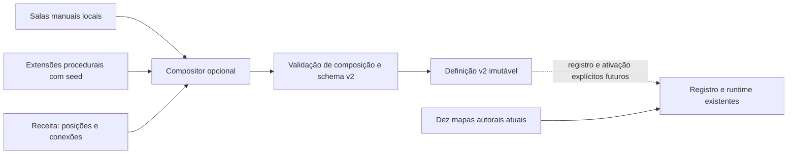

# Base de mapas híbridos — etapa inicial

Esta etapa foi precedida pela leitura de `game.js`, dos dez módulos de fase, de `campaign.js`, do registro/validador de mapas e dos módulos de runtime, inimigos, reparos, câmera, apresentação e testes. A composição nova é opcional. **Nenhuma das dez plantas nem o fluxo atual de carregamento foi substituído.**

## Contrato existente identificado

| Área | Como funciona hoje |
| --- | --- |
| Registro | `src/engine/maps.js` oferece `ByteRunner.maps.register()`: copia JSON, completa listas/defaults, valida `schemaVersion: 2`, rejeita IDs duplicados e congela a definição. |
| Campanha | `src/maps/campaign.js` contém dez IDs. `game.js` resolve `PHASES` uma vez; `loadPhase()` seleciona por índice e chama `loadMap()`. |
| Instâncias | `loadMap()` descarta serviços anteriores, cria inimigos/componentes/coletas mutáveis, runtime de mecânicas, recursos visuais, timers e posição inicial. A definição permanece imutável. |
| Pisos | Os dez mapas atuais usam `map.ground.mode: 'explicit'` e segmentos `{id,x,y,width,height,collision?}`. O motor também mantém o modo antigo de chão global com poços; a nova API não o remove. |
| Plataformas | `entities.platforms`: retângulos explícitos, `fixed/moving/temporary/dangerous`, `collision`, movimento senoidal, duração, respawn e condições. `requiresComponentId` faz a plataforma aparecer após reparo. |
| Paredes e portas | Paredes são obstáculos retangulares; limites externos também são aplicados por `map.bounds`. Obstáculos podem desaparecer após reparo; portas usam `opensWhen`. O compositor preserva essas diferenças de semântica. |
| Coordenadas | O motor transforma dados de definição em retângulos `{x,y,w,h}` por `solids()`. Em mapas antigos, `anchor:'floor'`/`offset` dependem do viewport. Salas novas exigem coordenadas locais explícitas. |
| Física | R-07 usa caixa 34×48, velocidade básica 255, salto 690 e gravidade 1850. A colisão usa cruzamento de superfícies e resolução lateral; plataformas one-way não bloqueiam os lados. A força do salto não vem do desenho ou tileset. |
| Inimigos | Suporte, patrulha e visão dependem dos retângulos de colisão. `groundY`, `patrolMin/Max`, `navigationBounds`, `activationRegion` e limites da arena precisam acompanhar qualquer deslocamento de sala. |
| Objetivos | Condições por reparo, inimigo derrotado, flag e combinações `all/any/not`; objetivos por coleção de IDs, região ou condição. Existem também requisitos de portas/serviços e conclusão por chefe + pergunta. |
| Reparos | Componentes acionam sessões modais. Vencer muda `repaired`, emite evento, concede XP, libera geometria/serviços e salva. Definições explícitas de minigame são preservadas. |
| Checkpoints | Ponto `x,y` usa **y da superfície de apoio**. O início usa **y do topo do robô**. Há modos legacy/proximity/ordered/free; dados e ordem influenciam o respawn. |
| Câmera | Usa tamanho do mundo, eixos e offsets de acompanhamento; respeita limites e velocidades. O campo `layout` descreve a intenção, não gera uma pista. |
| Salvamento | `byteRunner.campaign.v1`: ID/índice/revisão da fase, XP, habilidades, checkpoints, flags e mecânicas. Parte dos inimigos, componentes e coletas ainda é restaurada **pela ordem nas listas**. Não se pode reordenar essas listas silenciosamente. |

As fases atuais variam entre planta horizontal, salas/hubs, ramificações, labirintos e subidas verticais; Servidores inclui uma arena elevada. Seus dados completos continuam nos mesmos arquivos de `src/maps/`.

## Módulos novos

| Arquivo | Responsabilidade |
| --- | --- |
| `src/generation/random.js` | RNG com seed explícita, inteiros, escolha e subfluxos por sala. Não usa `Math.random`; o subfluxo de uma sala não depende da ordem de consumo de outra. |
| `src/generation/config.js` | Versão da arquitetura, grupos aceitos, limites de tamanho/quantidade e relação tema → tileset/cenário/fundo/paleta. Não duplica as constantes da física. |
| `src/generation/validation.js` | Contrato de sala local, receita de composição, limites e validação da definição final pelo validador existente. |
| `src/generation/composer.js` | Registros privados de templates e extensões de geração; instancia fontes, posiciona salas, resolve âncoras, verifica sockets/grafo, qualifica IDs/referências e retorna uma definição v2 congelada. |

Os quatro scripts são carregados após `maps.js`, antes do jogo. Não registram templates, geradores ou fases automaticamente. **`game.js`, `campaign.js` e os dez arquivos de fase não foram editados.**



## API inicial

```javascript
const generation = ByteRunner.mapGeneration;

generation.authored('phase-01'); // a mesma definição do registro atual
generation.registerRoom(roomTemplate); // {id, version, width, height, ...}
generation.registerGenerator({
  id: 'meu-gerador',
  version: 1,
  generate({roomId, random, config, material}) {
    // Retornar dados de uma sala local, usando random para variações.
    return minhaFabricaDeSala({roomId, random, config, material});
  }
});

const definition = generation.compile(recipe);
// compile NÃO registra a fase, altera a campanha, grava save ou carrega o jogo.
```

O exemplo mostra os pontos de extensão, não instala um gerador. O exemplo executável completo, com uma sala manual e uma fábrica de teste, está em `tests/generation.js`; essas fontes só existem no perfil temporário de testes.

Geradores são funções síncronas que retornam dados JSON. Precisam ser puros em relação à seed/configuração e consumir o RNG recebido. O compositor não pode impedir que uma extensão escrita externamente use aleatoriedade global; isso faz parte do contrato e deve ser testado.

## Sala local e receita

Uma sala usa `id`, `version`, `width`, `height`, `ground[]`, `entities{}`, `anchors{}` e `sockets[]`. Pode conter checkpoints, objetivos, assets, layers e as mecânicas atuais de portais, ambiente e vigilância. IDs locais não contêm `:`. A geometria é escrita em pixels locais; largura/altura são explícitas. Não há ancoragem ao chão global em salas compostas.

Uma receita usa:

- `id`, `name`, `theme`, `seed`, `revision` opcional e `size:{width,height}`;
- `rooms:[{id,template,x,y} ou {id,generator,config,x,y}]`;
- `start:{room,anchor}`, `exit:{room,anchor,width?,height?}`;
- `links:[{from:{room,socket},to:{room,socket}}]`;
- objetivos/missão e condição de conclusão opcionais, no contrato v2.

Cada placement precisa de um ID estável e exatamente uma fonte. A ordem dos placements é preservada na saída, assim como a ordem das entidades de cada sala. Salas sobrepostas, fora dos limites, fontes desconhecidas, sockets desalinhados/reutilizados e grafo desconectado são rejeitados. O mapa composto usa chão explícito, câmera nos dois eixos, progresso por objetivos e checkpoints ordenados nesta primeira versão.

Um socket é um marcador numa borda, com direção west/east/north/south. Para conexão direta, os dois marcadores devem coincidir em coordenadas globais e ter direções opostas. **Isso não recorta uma porta nem constrói corredores:** a sala manual/fábrica deve deixar o espaço físico correto. O grafo declara conectividade; não prova que R-07 consegue passar. A verificação física vem depois, antes de ativar geração na campanha.

## Referências e áreas especiais

O compositor transforma `repair` na sala `left` em `left:repair`, sem renomear IDs de assets globais. Aplica a mesma qualificação a condições, portas, objetivos, flags locais e IDs de mecânicas.

- `repair`: referência local à sala de origem;
- `left:repair`: referência explícita entre salas;
- `global:power`: flag compartilhada explícita, preservada literalmente.

Use flags públicas declaradas por interativos. Flags internas como `used:*` pertencem ao runtime e não são um formato de referência de sala.

São deslocados retângulos, pontos, checkpoints, regiões de objetivo, itens de cenário, limites de patrulha/navegação/arena e regiões de ativação dos inimigos. Velocidades, raios, timers, configurações de reparo e parâmetros de movimento não recebem deslocamento.

Portais aceitam destino local `{x,y}` ou destino por âncora `{room,anchor}`. Zonas ambientais e regiões de câmeras recebem o mesmo deslocamento da sala. Mecânicas de sala desconhecidas e layers em espaço de tela são rejeitados nesta versão, para evitar transformações silenciosamente erradas. Isso não restringe mapas autorais existentes, que continuam no caminho original.

Assets repetidos com a mesma definição são compartilhados; definições conflitantes com o mesmo ID são rejeitadas. O resultado inclui `generation.recipe`, seed, versão e proveniência/versões das fontes, mas ainda não é um novo formato de salvamento.

## Compatibilidade e persistência

`authored(id)` retorna o objeto original do registro. A composição não é executada pela campanha. Não houve alteração nas dez plantas, na física, no XP, nas habilidades, nas perguntas, nos minigames ou no formato de save.

Antes de ativar mapas gerados numa etapa futura será necessário:

1. Definir explicitamente onde o provedor de mapas entra antes da montagem de `PHASES`/carregamento da fase.
2. Persistir receita/seed, versão do compositor e versões das fontes; reconstruir a mesma geometria antes de restaurar posições e listas. Em mudança incompatível, usar a política de revisão e migração, sem perder XP/habilidades.
3. Garantir IDs e ordem estáveis ou migrar os trechos do save ainda baseados em índices.
4. Validar spawn, saída, checkpoints, saltos, corredores e objetivos com a física real e atributos básicos; verificar inimigos, efeitos de reparo e resposta errada com repetição obrigatória.

Nenhuma dessas mudanças de ativação/migração foi feita nesta etapa.

## Integração planejada com pixel art

O catálogo fornece `tileSize:32`, `tiles-01`…`tiles-10`, `decor-01`…`decor-10`, `sky-01`…`sky-10` e paleta por tema. O resultado registra essa informação em `generation.presentation`. Colisões não são derivadas do alfa de uma imagem.

Os assets atuais têm IDs globais reutilizáveis. Layers de uma sala podem apontar para eles, e seus elementos têm coordenadas transformadas pelo compositor. A apresentação pode continuar usando recorte, padrões em cache, framebuffer e nearest-neighbor.

O renderer atual ainda escolhe parte dos recursos pelo índice da fase e pelos renderizadores de tema existentes. A próxima integração deve consultar primeiro `generation.presentation` e manter o comportamento atual como fallback. Também será necessário desacoplar a seleção padrão dos minigames do índice da campanha para salas/temas novos, sem alterar os dez slots atuais. O serviço de caches opcionais hoje reconhece IDs `phase-XX`; ele também precisará de uma estratégia de sala antes da ativação de fases geradas.

## Verificação desta etapa

`tests/fixtures/pre-generation-hashes.json` registra os hashes de `game.js`, de `campaign.js` e dos dez módulos antes das mudanças. `python tools/check_generation.py` confirma preservação byte a byte e ordem de scripts. Esse guard é específico desta etapa; uma mudança futura de geometria, explicitamente autorizada, deve substituir o baseline de forma revisável.

`tests/generation.js` verifica inatividade na campanha, sementes/subfluxos, registros, reprodução de receita, imutabilidade, ausência de registro automático, namespaces, referências entre salas, flags globais, deslocamento de inimigos/portais/câmeras, erros de composição e execução de movimento/reparo/porta no runtime atual. O fixture carregado no motor não é inserido na campanha e desativa apenas seu salvamento de campanha no perfil de teste.

Comandos:

```powershell
python tools/check_generation.py
python tools/check_maps.py
python tests/run_review.py --generation-only
python tests/run_review.py
python tests/run_browser_audit.py
```

Resultados executados nesta etapa:

- Guard de preservação e verificador dos dez módulos: aprovados.
- Suíte específica de geração: 10/10, sem erros.
- Regressão completa: dez fases e 96/96 verificações de sistemas, sem erros de runtime; 68 capturas.
- Auditoria de interface: 70 cenários em sete resoluções, teclado, toque e restauração após reload aprovados; 70 capturas, sem erros de console. A primeira execução teve deslocamento de teclado abaixo do limiar; a repetição passou sem alteração do jogo. Isso registra uma instabilidade de temporização do teste, sem provar sua causa.

Os resultados ficam em `tests/generation-results.json`, `tests/review-results.json` e `tests/browser-audit-results.json`. A regressão usa instrumentação, proteção de dano durante travessia e reposicionamento entre arestas de salto/portal verificadas; não representa uma partida humana contínua. Equilíbrio de combate e experiência de exploração continuam exigindo teste manual.

Validação estrutural não substitui um solver de alcançabilidade ou testes humanos. A arquitetura inicial não possui escolha automática de salas, montagem aleatória de grafo, corredores automáticos, alteração da campanha ou geração durante respawn.
