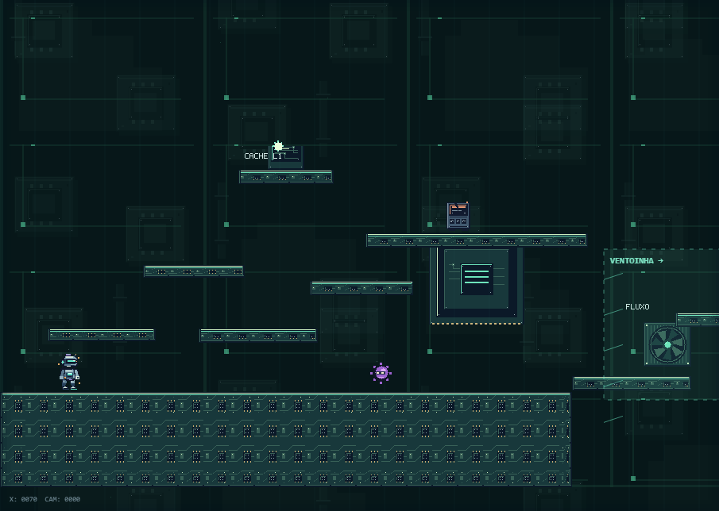
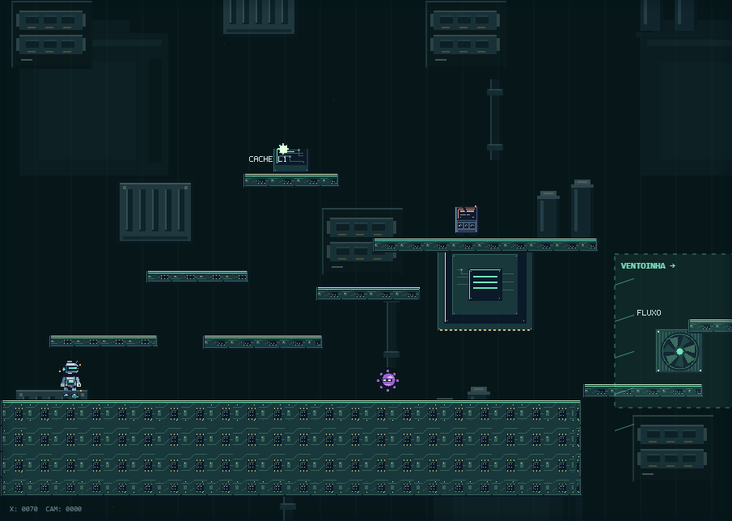
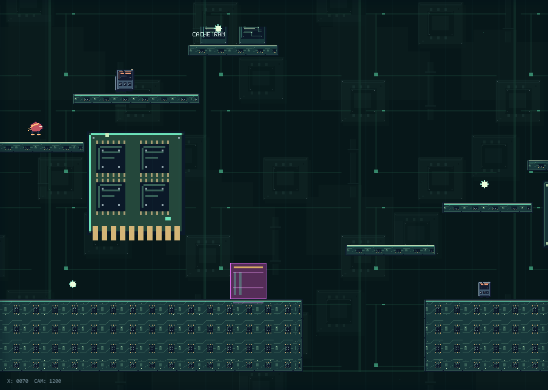
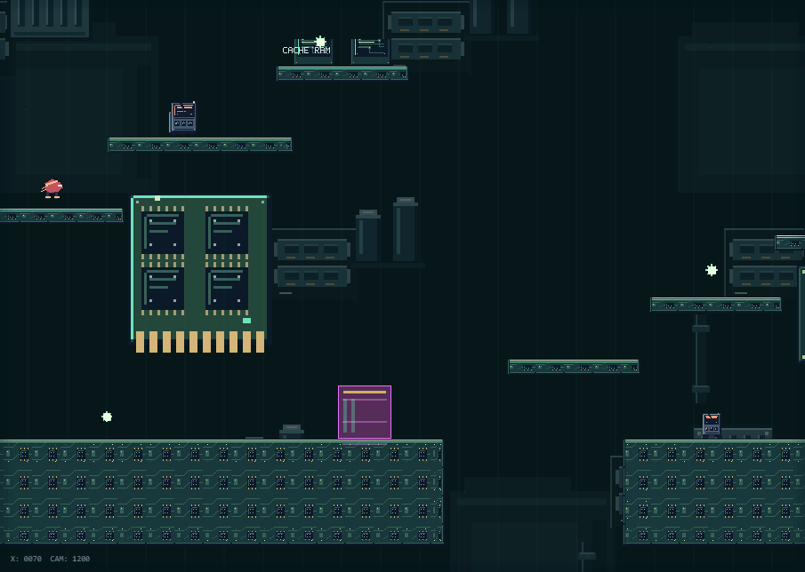
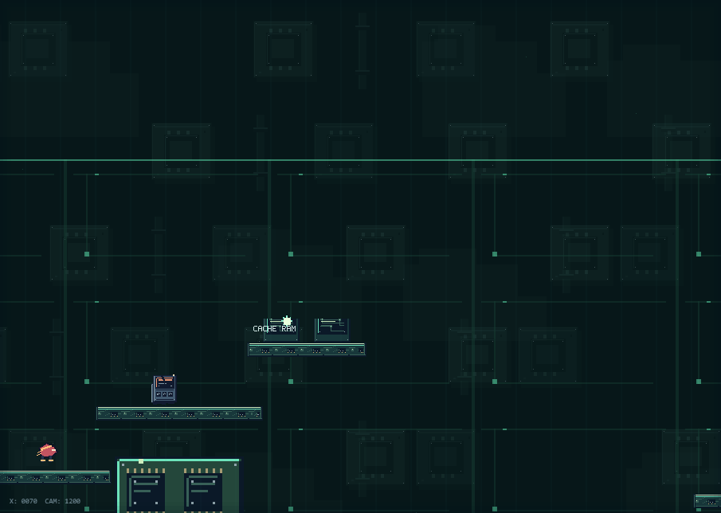
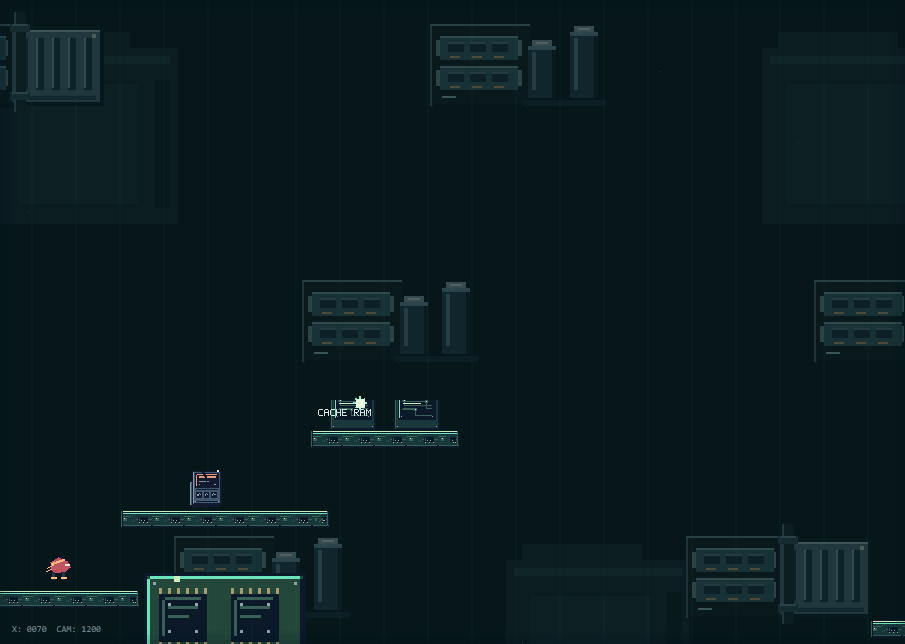

# Fase 1 — revisão artística do parallax

Capturas reais do Canvas com câmera e tempo idênticos antes/depois (tempo 1,2 s).

| Vista | Antes | Depois |
| --- | --- | --- |
| Início — câmera (0, 356) |  |  |
| Horizontal — câmera (1200, 356) |  |  |
| Vertical — câmera (1200, 0) |  |  |

Inspeção: a grade contínua desapareceu. Os módulos repetidos de CPU deram lugar a bancos de memória, dissipadores com aletas e pares de capacitores. Silhuetas grandes e recessos usam poucos tons azul-esverdeados; contatos dourados são discretos. Não há gradientes, halos ou suavização. As marcas de material usam blocos de dois pixels, com bordas de um pixel nos módulos de tamanho nativo e escala inteira no plano distante.

O intervalo vertical entre fileiras dobrou, deixando regiões vazias entre os grupos. As silhuetas distantes têm contraste menor que os módulos intermediários; plataformas e personagem preservam seus contornos claros. Na vista inicial, o personagem permanece sobre uma região escura sem iluminação de fundo forte. O fundo continua modular e repete ao longo do mapa, mas sem a malha de circuitos cobrindo a tela.

Foram mantidas quatro partículas discretas. A textura densa do piso pertence às plataformas e permanece nesta etapa; esta revisão trata do fundo.

Validação: 7/7 testes de profundidade e 12/12 testes de parallax passaram, sem erros de runtime. Bordas dos atlas, movimentos nos dois eixos, efeitos reduzidos, ordem de desenho e limite de cache verificados. Não foi executada a suíte completa nem um benchmark de FPS nesta etapa.
